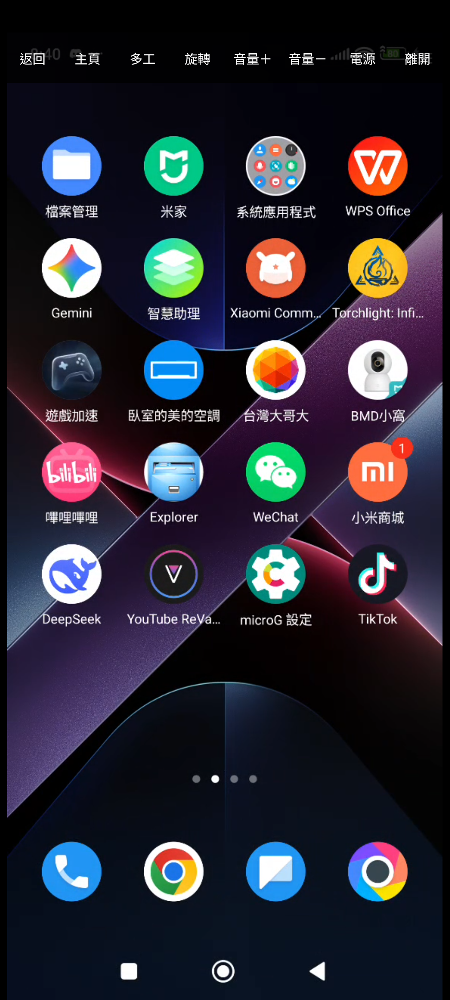

# OmniADB-Client

> **用手機控制另一支手機。** 掃描 → 配對 → 安裝 Host → 連線，全程不需要電腦。

<p align="center">
  
  
  
  
  <a href="https://github.com/tokyoxpa3/OmniADB-Client/actions/workflows/build.yml"></a>
</p>

<p align="center">
  
</p>

`OmniADB` 家族的第三塊拼圖，也是目前的主力：

| 專案 | 角色 | 平台 | 狀態 |
|---|---|---|---|
| [`OmniADB-Host`](https://github.com/tokyoxpa3/OmniADB-Host) | 被控端 —— 釘住 ADB 埠、重開機自己爬回來 | Android | ✅ 已發布 |
| **`OmniADB-Client`** | **控制端 —— A 機控 B 機** | **Android** | **✅ 0.4.7** |
| `OmniADB`（Python） | 電腦端控制台 / 多機監控牆 | Win / mac / Linux | ⏸ 擱置 |

> 為什麼名字是「角色」而不是「架構」：x86/ARM 是發行檔的事，同一個專案可以同時出
> `-win-x64` 與 `-mac-arm64`，不該進專案名。真正需要一眼分清楚的是**這支程式站在
> 哪一邊** —— Host 是被控、Client 是主控。

---

## 要解決的問題

電腦版 `python -m omniadb setup` 已經很順，但它要求你**人在電腦前**。
實際場景常常不是這樣：手機放在架上、在另一個房間、或根本沒有電腦在旁邊。

所以把整套流程搬到手機上：

```
python -m omniadb setup -s 192.168.1.192:5555     ←  電腦版
OmniADB-Client：掃描 → 配對 → 安裝 Host → 連線     ←  手機版
```

功能對照：

| 電腦版 | 手機版 | 狀態 |
|---|---|---|
| `setup` 一鍵推送安裝 + 授權 + 釘埠 | 配對後自動安裝 Host 並跑完同樣六步 | ✅ 已實作 |
| `devices` 列出裝置 | 掃描 mDNS + 記住的裝置清單 | ✅ 已實作 |
| `info` 印裝置資訊 | 點「詳情」 | ✅ 已實作 |
| `install app.apk` | 點「安裝 → 選 APK」，帶進度條 | ✅ 已實作 |
| `video` 螢幕鏡像 + 觸控 | 點「鏡像」全螢幕鏡像 + 多點觸控 + 按鍵列 | ✅ 已實作 |
| `push` / `pull` 傳檔 | 點「檔案」：兩邊列目錄、多選互傳 | ✅ 已實作 |
| —（電腦版沒有） | 對方畫面截圖存本機 | ✅ 已實作 |
| `record` 錄影 | 「設置 → 錄影」，H.264 直封裝 MP4（可帶 AAC 音軌） | ✅ 已實作 |

---

## 架構

### 為什麼控制端能直接講 ADB

Android 上沒有 `adb` 這支執行檔，但 ADB 協定本身是公開的。
[`libadb-android`](https://github.com/MuntashirAkon/libadb-android)（Apache-2.0）
用純 Java 實作了 client 端：TLS 握手、SPAKE2 配對、stream 多工。

`OmniADB-Host` 已經在用同一套函式庫（它拿來對**自己**下 `tcpip:5555`）。
控制端是把它反過來用 —— 連**別人**：

```java
// Host：連自己
manager.connect("127.0.0.1", 40589);

// Client：連遠端，API 完全一樣
manager.connect("192.168.1.192", 40589);
```

`AdbClient.java` 因此是**移植 + 升級**，不是重寫。兩處關鍵差異：

1. **Host 每次呼叫都 new 一個 manager 再 close** —— 適合「跑一條 shell 就結束」。
   鏡像要一條長連線同時掛兩條 stream（影像 + 控制），所以這裡 manager 留著重用。
   一次 TLS 握手 200~400 ms，60fps 的管線不可能每條 stream 重握一次。
2. **補上 `push`**。Host 不需要傳檔，Client 要把 Host APK 推過去。
   ADB 的 stream **沒有 half-close**（`AdbStream.close()` 送的是 CLSE，整條收掉），
   所以 `pm install -S` 那條路（寫完位元組再關 stdin）走不通，必須實作 SYNC 協定。

### ★ Host 配對過 ≠ Client 可以直接連

這是最容易誤會的一點，值得寫清楚。

`/data/misc/adb/adb_keys` 是**逐把金鑰**的清單。Host 在 B 上配對成功時，
寫進去的是 **Host 自己那把公鑰**；A 的 Client 是**另一把**金鑰，
所以 B「已經配對完成、埠也釘在 5555」對 A 完全沒有幫助 —— A 一樣是未授權。

而且 Host 也幫不上忙：`adb_keys` 是 `system:shell 0640`，shell 只能讀不能寫，
Host 手上只有 `WRITE_SECURE_SETTINGS`，更碰不到這個檔案。

**A 一定需要授權。** 協定層有兩條路，兩條都可行，但適用場合不同：

| 路徑 | 對方要人顧嗎 | 適用埠 | libadb | 本專案 |
|---|---|---|---|---|
| ① 系統對話框（按「允許」） | 要，框只活約 30 秒 | **5555**（Host 釘住的那個） | ✅ 可行 | ✅ 已實作 |
| ② 配對碼 SPAKE2 | 要，要輸入 6 位數 | 任何（用 mDNS 掃到的配對埠） | ✅ `pair()` | ✅ 已實作 |

兩條路都是**一次性**的：金鑰寫進 `adb_keys` 之後，之後連線完全免驗證。

#### 為什麼①只對 5555 有效（2026-10-24 實測）

同一個未知金鑰，連不同的埠，行為完全不同：

| 目標埠 | adbd 反應 | 有沒有彈框 |
|---|---|---|
| `5555`（`adb tcpip 5555` 釘住的明文埠） | 走 `A_AUTH` 挑戰 → 送公鑰 → 觸發 `UsbDebuggingActivity` | ✅ 有 |
| mDNS 掃到的隨機 connect 埠（例：`33493`） | TLS 握手階段就用 `SSLV3_ALERT_CERTIFICATE_UNKNOWN` 拒絕 | ❌ 沒有 |

所以「請求授權」要有效，前提是對方已經用 `OmniADB-Host` 把埠釘在 5555；
只靠 mDNS 掃到的隨機埠，一定得走配對碼。UI 兩種按鈕都留著就是這個原因。

> 曾經誤判「libadb 在 TLS 上不處理 `A_AUTH`，所以永遠不會彈框」。
> 那是假的 —— 未打補丁的 libadb 1.0.1 在 5555 上照樣彈出授權框（有截圖為證）。
> 當時的錯誤來自自動化點擊落到了清單裡另一列（TLS 埠），把「埠不對」
> 誤讀成「函式庫不支援」。

#### 授權：撐住那條連線，不要斷

**先更正一個以前寫錯的結論。** 之前這裡寫「按下『允許』後 adbd 會收掉原本那條
未授權連線，必須重連才偵測得到」—— 那是**因為我們自己每 5 秒就把連線關掉**造成的。
實測（POCO / HyperOS，2026-10-25）：只要那條連線還活著，使用者按下「確定」之後
`waitForConnection()` 會直接返回 true，**同一條 socket 就能完成握手**，
從按下到「已連上」全程 **1438 ms**。

反過來說，斷線是有代價的：那個授權框綁在**發起請求的那條 transport** 上。
連線一斷，框就變成沒有收件人的孤兒 —— 它還畫在螢幕上，但按「取消」或「確定」
**完全沒反應**（實測，只能重開機才清掉）。所以「短逾時 + 重試」不只是多餘，
它還會把對方手機弄成一個點不動的死框。

現在的 `AdbClient.authorize()` 分兩階段：

| 階段 | 做法 | 為什麼 |
|---|---|---|
| 一、撐住 | 開一條連線不動，最多 25 秒 | 框綁在這條 transport 上，撐著才按得動；按下即通 |
| 二、重試 | 撐不住才退回 5 秒一輪的重連 | 撐住階段逾時（沒人按）時的保底 |

#### 為什麼「已經可以連，卡片卻一直顯示待授權」

這是回報過的 bug，根因有三層：

1. **探測用 `setThrowOnUnauthorised(true)`**。看 libadb 1.0.1 的位元組碼，
   `waitForConnection()` 收到第二次 `A_AUTH`（也就是「框已經彈出來、正在等人按」）
   就立刻丟 `AdbAuthenticationFailedException` 收工 —— 所以探測 600 ms 就失敗了，
   它**根本等不到**使用者按「允許」。
2. **失敗之後再也沒有人去連第二次**。使用者按下「允許」、`adb_keys` 已經寫入、
   鏈路已經可用，但清單上那一列還停在「待授權」。
   而「鏡像」「詳情」會自己新建連線，所以它們一切正常 —— 這就是
   「顯示未授權，但實際可以連」的矛盾。
3. 於是只能手動再按一次「請求授權」，而它往往**第一次嘗試就成功**。

修法：探測判定未授權之後，自動接手 `authorize()` 在背景等（卡片顯示
「等待對方允許…」），對方一按就自動重新探測。只在使用者主動發起的探測
（手動新增）上開 —— 開 App 時對清單每一列都自動連，等於在別人的手機上輪流彈框。

#### 順帶修掉的兩個誤判

**`"Connection failed"` 不是「未授權」。** libadb 的兩條失敗分支是分開的：
`mAuthorisationFailed` → `AdbAuthenticationFailedException`，其餘（逾時、對端斷線、
TLS 失敗）→ `IOException("Connection failed")`。以前把後者也當成未授權，結果
**埠沒開、逾時、對方 adbd 剛重啟**全都顯示「請在對方手機按允許」，把人指錯方向。
現在改成看例外型別。

**TLS 被拒要單獨說。** mDNS 掃到的隨機 connect 埠走 TLS，沒有憑證就在握手階段
被 `SSLV3_ALERT_CERTIFICATE_UNKNOWN` 拒絕，adbd **不會**彈框（只有 5555 明文埠
才會走 `A_AUTH`）。這種情況現在顯示「憑證不被信任 —— 這個埠要走配對碼配對」，
而不是含糊的「連線失敗」。

> 換句話說：**沒有憑證時，只有 5555 這條路能靠「按允許」打通**；
> 一旦配對過、憑證互信，隨機埠也能直接連 —— 那時就不需要 5555 了。

對「無人職守」的場景，配對仍需有人碰一下 B，這是 Android 的安全邊界，繞不過。
真要完全免人工，只有一個辦法：**A 使用 B 上已經授權的那把金鑰** ——
但那就等於把 B 的 ADB 私鑰複製出去，安全性上不能做。

### 為什麼「安裝」不是 `pm install` 就結束

這是電腦版踩出來的結論，手機版照抄。Host 裝好之後**什麼都不會做**，它需要三樣東西：

| 條件 | 沒有它會怎樣 | 怎麼給 |
|---|---|---|
| `WRITE_SECURE_SETTINGS` | 重開機後無線偵錯是關的，沒人會去開 | `pm grant`（shell 權限就夠） |
| 被啟動一次 | 服務是 `exported=false`，控制端 start 不了 | `am start` 開 Activity |
| 金鑰不過期 | 一週後 ADB 金鑰失效 | `adb_allowed_connection_time=0` |

三件事都只要 shell，而我們連上 B 之後拿到的正是 shell ——
所以整個 `omniadb setup` 的六步可以在手機 A 上一次跑完。

### 遠端安裝 APK：整條流程只有一條 stream

`adb install` 是 adb **server** 的功能，libadb 沒有。所以「把 APK 從 A 裝到 B」
要自己拼：傳檔 → `pm install` → 清理。這條路上有四個坑，全部實測過：

**① 不能開第二條 stream。** 傳完 ~50 MB 之後，那條 `AdbConnection` 會變成
「半死」狀態：再開新 stream 會卡在 `AdbConnection.open()` 裡那個**沒有逾時的
`wait()`**，永遠不返回。換一個全新的 `AdbClient`（= 另一條 TLS session）也一樣
—— 新 session 確實連得上，但它的第一條 stream 要等到安裝那條關閉才拿得到回應。

**② ADB stream 沒有 half-close。** `AdbStream.close()` 送的是 `CLSE`，整條收掉，
做不到「只關寫入端表示 EOF」，所以 `pm install -S <size>` 那條路走不通。
解法是叫遠端跑 `head -c <size>`：它**收滿剛好 N bytes 就自己結束**，
串流由對端關閉，讀到 EOF 就等於「確實寫完了」。
（曾經用 `base64 -d > file` 硬幹，尾段會少 109 bytes —— 關串流把 base64 砍了。）

**③ 不能靠 EOF 判斷「安裝結束」。** 遠端腳本明明跑完（暫存檔都清掉了），
libadb 這邊的 `read()` 還是阻塞等不到 EOF（thread CPU 0%，不是忙迴圈）。
所以腳本最後固定印一個 `OMNIADB_DONE`，本機看到記號就收工，完全不等 EOF。

**④ 小米／HyperOS 會跳「USB 安裝提醒」。** 那是
`com.miui.securitycenter` 的 `AdbInstallActivity`，內容是
「…正在通過USB安裝此應用程式，是否繼續？」，**倒數只有 10 秒**，
沒人按就自動拒絕，`pm install` 於是以
`INSTALL_FAILED_USER_RESTRICTED: Install canceled by user` 收場 ——
這個訊息完全看不出真正原因是「沒人按按鈕」。

它跟開發者選項的「USB 偵錯（安全設定）」無關，也不是 `adb_install_need_confirm`
（那個值本來就是 0，框還是照跳）。**電腦上直接 `adb install` 也一樣被擋**。

因為 B 機通常不在手邊，所以由控制端代按：安裝期間在**對方機器上**跑一個
小看門狗，看到 `AdbInstallActivity` 就 dump UI、抓 `android:id/button2`
（＝「繼續安裝」，注意 `button1` 是「拒絕」，跟一般 Android 相反）、算出中心點、
`input tap`。看門狗刻意放在對端跑，是因為坑① —— 這條連線開不了新 stream。

整條指令最後長這樣：

```sh
head -c <size> > /data/local/tmp/x.apk
pm install -r -d /data/local/tmp/x.apk > out 2>&1 < /dev/null &
while 安裝還沒結束; do 看到 USB 安裝提醒就按「繼續安裝」; done
cat out ; rm -f x.apk out
```

實測 49 MB 的 APK：上傳 3 秒、代按到 `Success` 再 3 秒，暫存檔清乾淨。

### 螢幕鏡像

不走「`screencap` 輪詢」（1~3 fps，控制手感全無），走 scrcpy-server：

```
A: push scrcpy-server-4.1.jar → /data/local/tmp/omniadb-scrcpy.jar
A: shell CLASSPATH=… app_process / com.genymobile.scrcpy.Server 4.1 …   ← 這條要一直開著
A: openStream("localabstract:scrcpy")   ← 第 1 條：影像（H.264）
A: openStream("localabstract:scrcpy")   ← 第 2 條：控制（觸控 / 按鍵）
A: MediaCodec 解碼 → SurfaceView；觸控事件寫回控制 stream
```

關鍵是 **不需要 `adb forward`**。`forward` 是 adb **server** 的功能，
libadb 只做到協定層；但我們可以直接對 `localabstract:scrcpy` 開 stream，
效果完全一樣（電腦版 scrcpy 也只是 `adb forward` 之後連本機 TCP，繞了一圈）。

#### 4.1 跟 2.x 差在哪（實測，不是查文件）

影像／控制與音訊現在共用同一顆 **scrcpy-server 4.1**。升級前先用
`.probe/v41_probe.py`（PC 端、不經 App）在 POCO / Android 15 上把協定跑過一遍，
差別只有三處，其餘（觸控 32 bytes、按鍵 14 bytes、剪貼簿、`TYPE_ROTATE_DEVICE`）完全相同：

| 項目 | 2.7 | 4.1 |
|---|---|---|
| 影像標頭 | `dummy(1) + name(64) + codec meta(12)`，meta 自帶寬高 | `dummy(1) + name(64) + codec id(4) + session meta(12)` |
| frame flag | CONFIG=`bit63`、KEY=`bit62` | CONFIG=`bit62`、KEY=`bit61`（bit63 讓給 SESSION） |
| 尺寸更新 | 只能等新的 SPS | **session meta 夾在封包流中間**（旋轉／resize 時再插一筆） |
| 螢幕電源 | `TYPE_SET_SCREEN_POWER_MODE`（mode 位元組） | `TYPE_SET_DISPLAY_POWER`（boolean） |

session meta 與封包標頭**共用同樣的 12 bytes**，靠第一個 int 的最高位分辨：
是 1 就是 `flags + width + height`，是 0 就是正常的 `pts + size`。
（正常 pts 是微秒，碰不到 bit63，所以這個判準是安全的。）

**觸控的 `screenW/H` 必須等於 session meta 的尺寸**，不是裝置尺寸、也不該只信 SPS ——
伺服器就是拿 `PositionMapper.getVideoSize()` 在比對。實測送 `674x1280`（正確值 +100）
兩筆全被丟掉，而且那行 `Ignore positional event …` 是 **VERBOSE 等級**，
預設 log 完全看不到，症狀只有「觸控沒反應」。所以 Client 以 session meta 為準、
SPS 只在還沒收到 session meta 時當後備，兩者不一致會印警告。

實測結果（192 控 178）：握手 `574x1280`、點計算機的「7」→ 對方顯示 7、
旋轉後收到 `1280x574` 並重建解碼器、剪貼簿雙向正常、
`audio_dup=true` 時 SPEAKER 與 REMOTE_SUBMIX 同時有流量、我方 RMS 2700~5900。

#### 四個實測結論（每個都踩過）

**① `tunnel_forward=true` 不能省。**
設 `false` 時伺服器會反過來去連本機的埠（等於要求先做 `adb reverse`），
直接噴 `Connection refused`。只有 `true` 才是「伺服器開 abstract socket 等我們連」。
（順帶：2.x 的位元率參數叫 `video_bit_rate`，不是 1.x 的 `bit_rate`，
寫錯只會印一行 `Unknown server option` 然後照跑，很容易忽略。）

**② 兩條 stream 連同一個名字，而且順序不能顛倒。**
`tunnel_forward=true` 時伺服器只開**一個** `LocalServerSocket("scrcpy")`，
然後依序 `accept()` 三次（影像、音訊、控制）。所以「第一條連線」是影像、
「第二條」才是控制 —— 連反了會變成把觸控寫進影像串流，症狀是畫面不動、對方亂點。
另外，**只連影像不連控制，伺服器會卡在第二次 accept**：畫面一片黑，
看起來像「連上了但沒畫面」，其實它還在等控制連線。

**③ 握手開頭有 1 byte 的 dummy。**
影像 socket 依序是：`0x00`（1 byte）→ 裝置名（64 bytes，C 字串）→
codec meta（12 bytes：codec id `h264` + width + height）→ 封包流。
那顆 dummy 是 scrcpy 拿來「確認連線真的通了」的，**不讀掉它後面全部偏移一個 byte**
—— 症狀是裝置名變亂碼、尺寸變天文數字。

封包本身是 `8 bytes pts（bit63=config、bit62=keyframe）+ 4 bytes size + Annex-B 資料`。

**④ `cleanup=false`。**
伺服器預設會在結束時把 jar 刪掉。踩過：第一次連線失敗後 jar 就不見了，
第二次啟動變成 `ClassNotFoundException` → `app_process` 直接 SIGABRT
（logcat 只看到 `Aborted`，什麼都查不到）。

#### 解碼：MediaCodec 直接輸出到 Surface

不用「拿 ByteBuffer 自己畫」——那要多一次 YUV→RGB 轉換，在手機上直接吃掉兩三個核心。
MediaCodec 的輸出 Surface 就是 SurfaceView 的 Surface，解碼後的幀由 compositor 顯示，
全程不經過 CPU，這是 60fps 能成立的前提。

csd（SPS/PPS）**從 config 包拿，不用 codec meta**：codec meta 只有開頭那份，
旋轉之後就過期了；config 包則是每次編碼器重啟都會送。

#### 觸控座標：為什麼要自己解析 SPS

送給伺服器的觸控訊息長這樣：

```
type(1) action(1) pointerId(8) x(4) y(4) screenW(2) screenH(2) pressure(2) actionButton(4) buttons(4)
```

其中 `screenW/screenH` 會被伺服器拿去跟它**目前的**畫面尺寸比對，
**不一致就整筆丟掉**（它只印一行 `Ignore touch event, it was generated for a different device size`）。
而 codec meta 只在連線開始時給一次 —— 對方一旋轉，解析度就變了（1024×464 ↔ 464×1024），
meta 立刻過期，觸控就整片失靈。

所以我們自己解 SPS（`H264.spsSize()`，照 ITU-T H.264 7.3.2.1.1 的語法順序走到
frame cropping 為止），尺寸永遠跟解碼器實際在解的畫面一致。

#### 四個會直接閃退／黑屏／卡死的坑

**控制訊息不能在 UI 執行緒寫。**
`AdbOutputStream.write()` 是貨真價實的 socket 寫入，在主執行緒呼叫會丟
`NetworkOnMainThreadException` —— **手指一碰畫面 App 就掛**（實測）。
所以觸控只負責把位元組塞進佇列，寫入交給一條專屬執行緒（`omniadb-control-writer`），
順便保證 DOWN → MOVE → UP 的順序。

**Surface 會被系統收走。**
切到別的 App、螢幕熄滅、甚至只是被別的 Activity 蓋掉，SurfaceView 的 Surface 就被銷毀。
解碼器如果還握著它，MediaCodec 會報 `BufferQueue has been abandoned` →
`Codec reported err 0xffffffed/NO_INIT` 並**永久失效**。
所以 Surface 的掛上／抽掉都當成指令排進解碼佇列，由解碼執行緒單獨處理
（`VideoDecoder.attachSurface()` / `detachSurface()`）。

**一個 Activity 只能有一個 session。**
`launchMode` 用 `singleTask`，而且 `onStop()` 就關掉連線 —— 只 detach Surface 不夠，
實測反覆切前景會累積出好幾個 session，每個都在對方機器上留一個 `app_process`。

**關連線不能在 UI 執行緒做。**
`close()` 要關四條 stream、收 TLS socket、還要等解碼執行緒收工，慢的時候好幾秒。
在主執行緒呼叫的話，離開鏡像那一刻系統就判定 ANR：

```
Reason: com.omniadb.client/.MirrorActivity (server) is not responding.
        Waited 10003ms for MotionEvent
```

（`dumpsys activity lastanr` 查得到。這個 ANR 很容易被誤認成「觸控寫入卡住」——
其實是**離開時**才炸，畫面看起來完全正常。）
所以 `closeSession()` 把 session 交給一條 `omniadb-mirror-close` 背景執行緒再關。

#### 音訊（把對方的聲音帶過來）

開了 `audio=true` 之後，**一條 ADB 連線上就有四條 stream**，而且順序是死的：

```
shell:…app_process…         啟動 scrcpy-server
localabstract:scrcpy (1)    影像 H.264
localabstract:scrcpy (2)    音訊 裸 PCM
localabstract:scrcpy (3)    控制 觸控／按鍵
```

★★ **最惡毒的坑：伺服器要「三條都 accept 完」才送裝置名與 codec meta。**
所以舊版「連影像 → 讀 meta → 再連控制」的順序在開了音訊之後會直接卡死 ——
症狀是讀 meta 十秒逾時，log 裡什麼都沒有（伺服器那端也完全安靜，因為它只是卡在
第二個 `accept()`）。正確順序是：

```
連影像 → 讀 dummy byte → 連音訊 → 連控制 → 才讀 meta → 讀音訊標頭(4 bytes)
```

**音訊 socket 的標頭只有 4 bytes**（codec id，ASCII）。伺服器抓不到聲音時會改寫
**4 個 0** —— 那不是錯誤，是它明說「這台不能擷取」，我們就只跑影像、其餘照舊。

**為什麼是 `audio_codec=raw` 而不是 opus/AAC。**
scrcpy 伺服器用 `MediaCodec` 編音訊，而 POCO / Android 15 上那條路會死：

```
SecurityException: Given calling package android does not match caller's uid 2000
    at MediaCodec.setCallback → DeviceConfig.getProperties
```

（scrcpy 以 shell（uid 2000）身分跑，卻拿系統 context 去讀 DeviceConfig。）
實測 **opus / aac / flac 三種全部一樣下場**，只有 `raw` 完全不碰 MediaCodec。
代價是 48 kHz 立體聲 16-bit ＝ **1.54 Mbps**（實測 1535~1546 kbps），
好處是 Client 不必解碼，而且省掉每幀 21 ms ＋ 編碼器 lookahead 的延遲。

`AudioPlayer` 只有一個設計要點：**時鐘就是 `AudioTrack.write()`**。
MODE_STREAM 下它是阻塞的，緩衝滿了就等，等多久剛好等於播多久 ——
所以不需要節拍器、不需要丟幀邏輯，上游送太快自然會被背壓擋住。
緩衝取 `max(平台最小, 100 ms)`：這個數字**就是**延遲，100 ms 是「不天天 underrun」
與「嘴型還沒歪掉」之間的折衷（實測平台給 4800 幀 ≈ 100 ms）。
開播前先墊兩包（≈42 ms）再 `play()`，避免第一包就 underrun 的「喀」一聲。

**診斷看 RMS。** `AudioRecord` 在「擷取政策不符」時**不會拋錯，只會一直回全零**，
所以「連線正常、碼率正常、就是沒聲音」和「對方真的沒在播」從外面看起來一模一樣。
`AudioPlayer` 每 5 秒算一次 RMS 並印出來，連續 5 秒全零就大聲警告：

```
I OmniADB-Client: 音訊 1540 kbps，RMS=1559，累計 5034 ms
W OmniADB-Client: 音訊連續 5 秒全零 —— 對方沒在播，或那支 App 拒絕被擷取
```

**限制（都是 Android 的，不是我們的）**

| 限制 | 說明 |
|---|---|
| 對方要 Android 13+ | `AudioPlaybackCapture` 的硬門檻，12 以下伺服器直接停用音訊 |
| 只抓 `USAGE_MEDIA` / `GAME` | 通知音、通話、鈴聲抓不到 |
| App 可以拒絕 | `allowAudioPlaybackCapture=false`（DRM 影音、少數播放器） |
| 對方自己會變小聲 | `audio_dup` 預設 false（`ROUTE_FLAG_LOOP_BACK`），被控端不外放 |

工具列那顆「有聲／靜音」管的是**對方的喇叭**，不是本機音量（本機請按自己的音量鍵）。
它不能靠「調對方音量」實作：播放擷取是**音量之後**的訊號，對方調 0 我們這邊也全零
（實測 RMS 601 → 0），只能換 `audio_dup` 重開音訊那條 session。

音訊有三種狀態（`Settings.AUDIO_*`），**切換任何一種都不會重連影像** ——
音訊本來就是獨立的一條 session：

| 模式 | 音訊 session | 對方喇叭 | 我這邊 |
|---|---|---|---|
| 兩邊都有聲 `AUDIO_BOTH` | 開，`audio_dup=true` | 出聲 | 聽得到 |
| 只有我有聲 `AUDIO_CLIENT_ONLY` | 開，`audio_dup=false` | 安靜 | 聽得到 |
| 不要聲音 `AUDIO_OFF` | **不開** | 不受影響 | 聽不到 |

> **為什麼「不要聲音」不能做成勾選項**：勾起來就等於「沒有 session」，而
> `audio_dup` 只在 session 啟動時決定 —— 於是那顆按鈕再也不能控制對方喇叭，
> 使用者只會覺得「選了不要聲音之後，遠端的聲音就失控了」。所以它放在
> 「⋯ → 音訊…」裡當三選一；而工具列那顆按鈕在 `AUDIO_OFF` 時顯示「無聲」，
> 按下去是**把 session 接回來**（畫面不動）。

> **切換時要補 play，連線時不要。** 關掉舊 session 同樣是一次路由切換
> （REMOTE_SUBMIX → SPEAKER），一樣會發 `ACTION_AUDIO_BECOMING_NOISY`，ExoPlayer 系
> App 收到就暫停且不自己恢復 —— 所以「靜音↔有聲」與「關閉聲音」都會補一次
> `dispatch play`，否則「一開聲音／一選不要聲音，對方影片就停住」。
>
> 但**連線後的第一次啟動不補**：那時沒有舊 session 可關，不會發生上面那次搬移，
> 沒有東西要救；送了反而會把使用者**刻意暫停**的播放器叫起來（實測：一連上，
> 暫停中的 YouTube 就自己開始播）。判斷條件就是 `applyHostAudible()` 裡的
> `old != null`。代價仍然存在 —— 使用者刻意暫停之後才切換聲音，會被這一下叫回播放。

沒有音訊串流（對方 < Android 13、或擷取被拒絕）時那顆按鈕會變暗，按下去會明講
「對方沒有送出音訊」—— 免得變成「按了沒反應」這種最難查的故障。


#### 工具列要讓開狀態列

全螢幕（immersive sticky）下狀態列平常是隱藏的，但**手指點到畫面上緣時系統會把它拉出來**，
正好蓋在工具列上 —— 實測「返回」跟時鐘疊在一起。所以不能問「狀態列現在可不可見」，
要在 `OnApplyWindowInsetsListener` 裡直接保留它的高度，順便取
`DisplayCutout.getSafeInsetTop()` 的最大值（挖孔比狀態列還深）。

#### 工具列

頂端一條會自動收起的工具列，**只有七顆**：返回 / 主頁 / 多工 / 有聲·靜音 / **鍵盤** / **設置** / 離開。
5 秒沒動就收起來，點右上角的 `≡` 再叫回來。**系統返回鍵刻意不接管** ——
那是使用者離開鏡像最直覺的方式；要按對方的返回鍵，用工具列上那顆。

「返回」走的是 `TYPE_BACK_OR_SCREEN_ON` 而不是 `TYPE_INJECT_KEYCODE`：
螢幕熄著的時候它會先把螢幕點亮，不會把 BACK 送給鎖屏介面。

0.3.2 以前是十二顆（多旋轉 / 跟隨 / 音量 ± / 電源）。十二顆平分 1080px，每顆只剩 90px，
字級得壓到 10sp 才不折行 —— 而折行的代價是工具列變高、蓋住更多畫面。
那五顆一天可能只按一次，收進「設置」之後每顆按鈕有 154px，好按也好看。

#### 「設置」選單：對對方動手 + 本機設定

| 選項 | 做什麼 | 要不要重連 |
|---|---|---|
| 旋轉 | `wm user-rotation lock` 鎖方向，對方轉完本機才跟著轉 | 不用 |
| 跟隨本機方向 ☑ | 要不要跟著本機感測器自動轉（關掉就只能用上面的「旋轉」） | 不用 |
| 音量 | 開一個面板：`−` / `＋`，按住會連發（見下） | 不用 |
| 電源 | `KEYCODE_POWER`（不是 `SET_SCREEN_POWER_MODE`，見下） | 不用 |
| 關閉螢幕省電 ☑ | `SET_SCREEN_POWER_MODE(false)`；**會記住**，下次連上自動套用 | 不用 |
| 貼上本機剪貼簿 | 把本機剪貼簿的內容送過去並代按貼上 | 不用 |
| 畫質… | 720/2M/30、1280/6M/60、1600/12M/60 | **要**（`max_size` 只能在啟動時給） |
| 對方螢幕保持常亮 | `stay_awake`，對方不會自己睡著 | **要** |
| 音訊… | 三種模式（見上一節） | 不用 |
| 重新連線 | 手動重連 | — |

選單分兩段（API 28 以上會畫分隔線）：上面那一段是**對對方動手**，下面那一段是**本機這端的設定**。
「跟隨本機方向」「關閉螢幕省電」「保持常亮」是勾選項，勾＝現在開著。

**音量為什麼不是兩顆選單項**：`PopupMenu` 點一下就會關掉，調 5 格要把選單開 5 次。
音量本來就是「按住連續調」的操作，所以改成一個不會自己關掉的面板 —— 點一下走一格，
按住 400 ms 後開始每 100 ms 走一格，放手就停，面板留著可以再按。
（實測：長按 1.5 秒從 24 走到 0，剛好 12 格，跟設定的節奏一致。）

**「關閉螢幕省電」為什麼是一個勾，而不是「關閉／開啟」兩項**：送出去的永遠是**絕對值**
（勾→關、取消→開），不會有「切換錯方向、按了更暗」這種事 —— 那正是當初拆成兩項的理由，
但它同時也讓人每次都要先讀一遍才知道該按哪個。而且這個勾**會記住**（`Settings.hostScreenOff`）：
會勾的人理由通常是固定的（例如舊手機掛著當監看螢幕），每次連上都要再點一次只是折磨。
離開鏡像時仍然會自動把對方螢幕開回來（見下面「對方螢幕」），下次連上再自動關掉。

「電源」用 `KEYCODE_POWER` 而不是 `SET_SCREEN_POWER_MODE`：後者會動到系統的「螢幕電源狀態」，
對方拔線之後可能留在關閉狀態，風險比按一下電源鍵高。實測從選單按下去，對方
`mWakefulness` 會從 `Awake` 變 `Dozing`，再按一次就回來。

「貼上本機剪貼簿」跟下面的鍵盤不衝突：鍵盤是「打完直接出現在對方輸入框」，
這顆是「我已經複製好了，懶得長按」。

#### 打字：接上本機的輸入法

以前是「⋯ → 傳送文字…」，跳一個對話框讓你打字再按送出。那很蠢：字是在本機打的，
卻要繞一圈。而且它送不進中文 —— `TYPE_INJECT_TEXT` 是伺服器逐字用 `KeyCharacterMap`
轉按鍵事件，中文／emoji 根本沒有對應的按鍵（那是輸入法的產物）。

現在的做法：按工具列的 **「鍵盤」**，用本機的注音／拼音／Gboard 直接打，
打完的字直接出現在對方的輸入框裡，不用再按送出。想接實體鍵盤（藍牙／USB）也可以。

**兩條送出通道**，依內容自動選：

| 內容 | 走法 | 為什麼 |
|---|---|---|
| 純 ASCII（含 `\n` `\t`） | `TYPE_INJECT_TEXT` | 不碰對方剪貼簿，不會打斷對方正在複製的東西 |
| 中文／emoji／其他 | `TYPE_SET_CLIPBOARD(paste=1)` | 讓對方自己按貼上。4.x 用 `KEYCODE_PASTE`，只有這條路可靠 |

**怎麼拿到輸入法的字**：放一個 2dp 的透明 `EditText`（`onCheckIsTextEditor()` 回 true）
取得焦點，`onCreateInputConnection()` 回自訂的 `BaseInputConnection`，
只處理 `commitText()` / `setComposingText()` / `deleteSurroundingText()` / `sendKeyEvent()`。
**組字中的字不送** —— 打「你好」時輸入法會先送 `nihao` 五次組字事件，
照送的話對方螢幕上會出現一堆拼音，選完字還得倒回去刪。那是把本機的輸入法狀態洩漏出去。

##### 這段踩了四個坑，每個都花掉一輪除錯

1. **`BaseInputConnection.getEditable()` 在匿名子類裡回 `null`。**
   `super.setComposingText()` 之類全部靜默失敗，而且**還回 `true`**
   （log 顯示 editable 長度永遠是 0）。所以不要靠 super 維護文字，自己用一個
   `StringBuilder` 當緩衝。

2. **輸入法不是每按一鍵就 commit。** 三星／Gboard 打英文時每個字母送
   `setComposingText`，按空白才 commit —— 而且 commit 的內容**只有那個空白**，
   不是整個單字，因為它假設「kbd」這段組字文字早就躺在輸入框裡了。
   所以 commit 的語意要分兩種：
   - 還在組字中 → 這段是來**取代**組字區的（注音選字就是這種）
   - 組字已結束才來的 commit → **接在後面**（三星打英文按空白就是這種）

   只送 `commitText` 的參數 ⇒ 對方只收到一個空格，整個單字消失（實測）。
   照上面兩種語意處理，才會得到 `"kbd "`。

3. **`EditText.setShowSoftInputOnFocus` 預設是 `true`。**
   它在版面裡是唯一可聚焦的 View，一進場就自動取得焦點，於是**點「鏡像」等於
   「鍵盤自己彈出來」**。要關掉，鍵盤才只由工具列那顆「鍵盤」控制。
   （視窗的 `SOFT_INPUT_STATE_ALWAYS_HIDDEN` 管不到這件事，那是兩條不同的路。）

4. **三星注音只發 `commitText`，不發 `setComposingText`。**
   這件事害我查了很久：一直等「組字中」的日誌，等不到就以為壞了，
   其實它本來就不發 —— 判據要看成員選字後有沒有 `commitText`。

> 還有一個很容易誤判的：**被控端自己的鍵盤會出現在鏡像裡**。遠端是 1220×2712、
> 控制端是 1080×2400，長寬比一樣，鏡像會佔滿整個畫面 —— 於是「畫面下方那個鍵盤」
> 看起來就像控制端自己彈的。要分辨就 `dumpsys input_method | grep mInputShown`
> 兩台都查。

另外：**組字中按退格只能改本機緩衝**，不能真的送 DEL 過去，
否則會把對方輸入框裡更早的字刪掉。緩衝是空的時候按退格才送 `KEYCODE_DEL`。

**實體鍵盤**走另一條：那些按鍵不經過 `InputConnection`，是 `EditText` 自己把字元
插進 `Editable`，所以在 `TextWatcher` 裡補一次轉送。因為上面完全不碰 `Editable`，
這裡讀到的內容**只會**是實體鍵盤打的字，兩條路不會互相污染。

#### 測試入口：用 intent extra 走同一條程式路徑

`input tap` 在實機上點得到全靠運氣（工具列會自動收起、選單要點兩層）。所以所有設定
都留了 debug-only 的 extra，直接呼叫 UI 用的同一支方法 —— 驗的是協定與邏輯，不是座標：

```
-e quality 0|1|2       畫質
-e audiomode 0|1|2     音訊模式（0 兩邊都有聲 / 1 只有我有聲 / 2 不要聲音）
-e audiomodeat 6:2     連上 6 秒後在連線中切模式（驗「切音訊不重連畫面」）
-e noaudio 1|0         等同 audiomode 2|0
-e stayawake 0|1       對方螢幕常亮
-e sendtext "123456"   連上 3 秒後注入文字
-e sendkey 66          連上 3 秒後送一個 keycode
-e hostmute 1          一開始就對方靜音
-e audioflip 8         8 秒後按一次「有聲／靜音」
-e keyboard 1          連上 5 秒後按一次工具列的「鍵盤」（驗輸入法有沒有真的彈出來）
-e type "你好 hello"   連上 3 秒後把一段字「打」進對方，走和輸入法完全相同的那條路
-e typedelay 6         上面那個延到 6 秒
-e sinksize 40         把接收器放大到 40dp（不同輸入法對「這個編輯區算不算數」判斷不同）
-e heartbeat 1         每 3 秒在主執行緒寫一行，用來分辨「卡死」和「只是沒事件」
-e screenoff 1         連上 5 秒後關掉對方實體螢幕（驗鏡像照常；**會一併寫入「關閉螢幕省電」偏好**）
-e screenon 1          連上 5 秒後把對方螢幕開回來（同時清掉上面那個偏好）
-e screenoffat 8       連上 8 秒後關掉對方螢幕
```

`-e type` 為什麼不能改用 `adb shell input text`：`input text` 走的是 KeyEvent，
不經過 `InputConnection`，驗不到輸入法那條路。它驗的是實體鍵盤那條（也有用，
只是不是同一條）。

#### 剪貼簿：雙向同步

複製在**連線之前**做的也算 —— 這是整個功能最容易被做壞的地方。scrcpy 預設
`clipboard_autosync=true` 時，伺服器**只在對方剪貼簿「變動」的那一刻**推過來，
連線前就複製好的內容永遠拿不到。所以啟動參數改成 `clipboard_autosync=false`，
我們自己每 `600 ms` 送一次 `TYPE_GET_CLIPBOARD`（`{8, 0}`，`copyKey=0` 免得亂按鍵），
連線當下先抓一次：

| 方向 | 怎麼做 | 什麼時候生效 |
|---|---|---|
| Client → Host | `TYPE_SET_CLIPBOARD`（`paste=false`，只設剪貼簿不代按貼上），等 `TYPE_ACK_CLIPBOARD` | 連線當下＋連線中本機一複製就送 |
| Host → Client | 輪詢 `GET_CLIPBOARD`，寫進本機剪貼簿（label `OmniADB`） | 連線當下＋連線中每 600 ms |

**連線當下的衝突**（兩邊都有內容，剪貼簿只有一份）：看本機那筆多新。

1. 本機是使用者剛複製的（`ClipDescription.getTimestamp()` 在 10 分鐘內）→ 推給對方，本機不動。
   窗口給到 10 分鐘不是隨意：實測「複製 → 開 App → 掃描 → 對方按允許」在需要重新授權時
   很容易拖過 3 分鐘（授權框只活 30 秒，錯過就要重來），那時把使用者的複製丟掉是最糟的失敗。
   拿不到時間戳的機型（`getTimestamp()` 回 0）一律當成「剛複製」—— 判斷不了就別丟掉使用者的東西。
2. 本機這筆是**上一輪同步從對方抄來的**（label 是 `OmniADB`）→ 不算新，等對方那一筆。
   少了這個判斷，重連時會把對方在這段時間新複製的東西蓋回去。
3. 其他（舊內容 / 空的）→ 先等對方 1.2 秒；對方有東西就套用到本機，空的才推本機過去。

**回音**：把對方的內容寫進本機剪貼簿會觸發本機的變更監聽，處理不好就變成
「Host → Client → Host → …」互蓋。兩邊各留一份最後字串擋掉（`applied` / `pushed`），
另外 `ScrcpySession` 對輪詢讀到的同一筆也去重。

實測（Samsung SM-G9810 控 POCO / Android 15）踩到兩個坑，都在 `ClipboardSync` 裡寫了註解：

- **寫一次剪貼簿會回呼兩次**（Samsung）。第一次回呼後若把 `applied` 清掉，第二次就會被
  當成使用者的新複製而回送對方 —— 所以比對到 `applied` 就 `return`，**不要清**。
- **送出去之後 12 ms 還收到一筆舊資料**。那是我們送 `SET_CLIPBOARD` 之前就在路上的
  `GET_CLIPBOARD` 回應，內容是對方「被我們蓋掉之前」的東西，套用下去會把本機剛複製的內容蓋掉。
  送出後 900 ms 內的對方內容一律丟掉（`PUSH_SETTLE_MS`）。

實測（2026-10-25，SM-G9810 控 POCO / Android 15）：

| 場景 | 結果 |
|---|---|
| Client 連線前複製 → 連上 → 在鏡像裡長按貼上 | Host 剪貼簿由 `HOST-OLD-…` 變成 Client 的內容；log 依序是「本機有使用者複製的內容 → 推給對方」、server `Device clipboard set`，約 20 ms |
| 連線中在 Host 複製 | 3 秒內（輪詢 600 ms ＋ 一次往返）Client 剪貼簿變成同一筆，log「剪貼簿：對方 → 本機（13 字）」 |
| 連線中在 Client 複製 | Host 剪貼簿立刻被覆蓋，長按貼上即得 |

協定本身也單獨驗過（不經 App，直接對 scrcpy-server 發 `GET`/`SET_CLIPBOARD`）：
Android 13（SM-G9810）與 Android 15（POCO）都能讀到連線前就存在的內容、也都能寫入並讀回。

除錯用的 intent extra（只有 debug 建置有效）：`-e clip "文字"` 預置本機剪貼簿、
`-ez clipclear true`（或 `-e clipclear 1`）清空。實測 Samsung 清完會立刻把上一筆還原回來，
所以想模擬「本機沒內容」時看 log 有沒有印「清空後仍然有內容」。

---

### 檔案總管：兩邊的檔案系統長得完全不一樣

**為什麼是「分頁」而不是左右兩欄**：直向只有 1080px，兩欄各 540px，
`Camera/IMG_20261026_193012.jpg` 這種名字會被截到看不出是哪一張。所以做成
「本機／對方」分頁，一次看一邊，選好之後按下面那顆「傳到對方」。

兩邊看起來都是「檔案」，底下的機制卻完全不同：

| | 對方 | 本機 |
|---|---|---|
| 怎麼列目錄 | ADB SYNC 的 `LIST` | SAF 的 `DocumentsContract` |
| 怎麼讀寫 | `RECV` / `SEND` | `openInputStream` / `openOutputStream` |
| 路徑長什麼樣 | `/sdcard/DCIM` | `content://…/document/primary:DCIM` |
| 需要什麼權限 | 一條已授權的 ADB | 使用者自己挑一個資料夾 |

**本機這一側刻意不用 `java.io.File`**。Android 10 之後 scoped storage 讓 App
根本看不到 `/sdcard`，硬要走那條路就得宣告 `MANAGE_EXTERNAL_STORAGE`
（上架會被退回，而且對使用者是過度授權）。改成 SAF：使用者自己挑一個資料夾，
我們只碰得到他挑的那一個 —— 不必求任何危險權限，權限也最小。

#### SYNC 協定：libadb 沒封裝，自己實作

`adb push` / `adb pull` 用的是 ADB 的 SYNC 協定。libadb 1.0.1 只做到「開一條具名
stream」，沒有這層封裝 —— 但通道本身是通的（`openStream("sync:")`），所以自己寫
`AdbSync`。**整段會話只開一條 stream**：這條連線在大量寫入之後會「半死」
（見上面安裝 APK 那段的說明），檔案總管如果每個檔開一條，傳三個檔就卡死。

協定有三個地方跟網路上的文件不一樣，每一個都會讓**下一條請求錯位**：

1. **`LIST` 的結尾是 `DONE` + 16 bytes**，不是 4。adbd 的 `do_list` 直接
   `memset` 一個 `sync_dent`（20 bytes）當結尾。只讀 4 bytes，剩下 12 bytes
   會留在緩衝區裡 —— 症狀是「列完一個目錄，之後所有操作都失敗」。
2. **`SEND` 的路徑要帶權限**：`/sdcard/x.jpg,0644`。純路徑會被回
   `FAIL: missing , in ID_SEND_V1`（這句話完全看不出問題在哪）。
3. **`DONE` 的時間戳放在 size 欄位裡**，後面沒有額外 payload。多寫 4 bytes
   會變成下一條請求的開頭 —— 症狀是莫名的 `FAIL: path too long`。

另外兩個行為也要記著：`STAT` 查不存在的檔案**不會回 FAIL**，而是回一個全 0 的
STAT（用 `mode == 0` 判斷）；adbd 送 `FAIL` 之後會**直接收掉連線**，
所以通道要標記死亡、下次重建。

驗證工具在 `.probe/sync_probe.py` —— 它從 PC 直接對 adb server 的 5037 講
`host:transport:` + `sync:`，不經過 libadb，可以單獨驗封包格式。改協定前先跑它。

#### 連線會被對方單方面收掉

實測（POCO 控 SM-G9810）：通道建好之後閒置約兩分鐘，回來要傳檔就得到
`java.io.IOException: Stream closed` —— 而且是**寫入的第一次呼叫**就失敗，
不是傳到一半。手機休眠、Wi-Fi 省電、系統凍結背景 App 都會造成這件事，
我方完全收不到通知。

兩個對策，缺一不可：

- **離開畫面就關連線**（`onStop`，傳輸中除外）。回來重連只要 200~400 ms，
  比抱一條可能已經死掉的通道划算。
- **失敗就重建連線重試一次**（`withSync`）。重試是安全的：`SEND` 會截斷重寫、
  `RECV` 的失敗路徑已經刪掉半成品、`LIST` 沒有副作用。注意要**連
  `AdbClient` 一起換掉**，只換 sync 通道不夠 —— 底層 TLS 可能也半死了。

#### 實測

| 方向 | 檔案 | 結果 |
|---|---|---|
| 本機 → 對方 | `1783271242866.png`（964,328 bytes） | 對方 `/sdcard` 出現，MD5 `79c534f0…` 兩邊相同 |
| 對方 → 本機 | `Screenshot_20250819_043130_Carousell.jpg`（561,782 bytes） | 本機 `Pictures/` 出現，MD5 `9d7d9e3c…` 兩邊相同 |

截圖：`shots/files2.png`（對方 `/sdcard`）、`files5.png`（本機資料夾）、
`files6.png`（選取 + 底部動作列）。

**麵包屑要顯示真實的根目錄名**：SAF 只給一個 `treeUri`，目錄堆疊的第一層沒有名字
（`DocumentsContract.getTreeDocumentId()` 只有 id），所以一開始麵包屑永遠寫死「本機」——
挑過 Pictures 和 Download 之後根本分不出自己在哪。現在挑完根目錄就用
`COLUMN_DISPLAY_NAME` 問一次名字並存進 `local_tree_name`，麵包屑變成
`Pictures / OmniADB`。舊存檔沒有這個鍵，啟動時補查一次（`shots/breadcrumb.png`）。

#### 管理操作：兩顆 ⋮，一顆管目錄、一顆管選取

| 位置 | 選單內容 |
|---|---|
| 路徑列右邊的 ⋮ | 新增資料夾、跳到路徑（僅遠端）／選本機資料夾、排序 |
| 底部動作列的 ⋮ | 全選、取消選取、改名（單選時）、詳細資訊（單選時）、刪除 |

**為什麼要兩顆**：一顆是「對這個目錄做的事」，一顆是「對選中的東西做的事」。
合成一顆會出現「選了三個檔案，選單裡卻有『新增資料夾』」這種邏輯上說不通的畫面。

**長按＝選取，而且目錄也能選**。目錄的「點」被「進入」佔走了，如果長按還不給選，
資料夾就永遠刪不掉、也傳不了 —— 那就不叫檔案總管了。

**返回鍵的順序是「取消選取 → 上一層 → 才離開」**。在 `/sdcard/DCIM/Camera`
按返回卻整頁關掉，要回去得從頭點進來，沒有一個檔案總管是這樣。

**換本機資料夾靠路徑列最前面那顆膠囊**（`OmniADB ▾`，帶底色）。本機這一側的根目錄是
使用者自己挑的 SAF 樹，所以「換一個根」是這裡獨有的動作，必須看得見 —— 原本它只藏在
`⋮ → 選擇本機資料夾` 裡，進來只看到一個資料夾名稱，沒人會想到那是可以換的。這顆
**永遠可點**（包括已經在根目錄時），因為它代表「換一個根」，不是「回上一層」；
後者是左邊那顆 `↑`。

> 試過讓返回鍵在根目錄時開選擇器：很怪。返回鍵在每一頁的意思都是「離開」，
> 在這裡突然變成「開一個選擇器」、第二次才離開，沒有人猜得到。
> 換資料夾是**正向的動作**，就該有一顆正向的按鈕。

**排序**：名稱 A→Z／Z→A、大小、修改時間，記在使用者偏好裡。**目錄永遠排前面** ——
照大小排的話目錄的 inode 大小（通常 4096）會讓一堆資料夾散在檔案中間。

#### 遠端的新增／改名／刪除只能走 shell

SYNC 協定 v1 只有 `STAT` / `LIST` / `RECV` / `SEND`，**沒有刪除、沒有改名、沒有 mkdir**。
所以這三個操作走 `shell:`，路徑一定要用單引號包起來：

```java
private static String q(String path) {
    return "'" + path.replace("'", "'\\''") + "'";   // it's.jpg 這種檔名真的存在
}
```

成功時 `rm`/`mv`/`mkdir` **一個字都不印**，所以判斷方式很簡單：在指令尾巴接
`echo @@OMNIADB:END`，記號之前只要有任何輸出就是失敗，而且訊息是遠端原文
（`Permission denied`、`No such file or directory`），不用自己猜。

`mv` 的重試要特別小心：通道有可能是在「`mv` 已經成功」之後才斷的，重試會找不到來源。
所以失敗時先用 `STAT` 問一次新路徑，在就當成功。

#### 兩個只有實際點下去才會發現的坑

1. **本機檔案的時間全是亂的**。SAF 的 `COLUMN_LAST_MODIFIED` 是**毫秒**，
   而 SYNC 協定給的是**秒**，`formatTime()` 只認秒。實測 2026-10-26 的檔案
   顯示成「05-10 15:24」—— 看起來像時區問題，其實是單位差了 1000 倍。
   現在 `listLocal()` 一律先除以 1000。
2. **`EditText` 不設 `inputType` 就打不進字**。`EditorInfo` 會是 `inputType=0`（NULL），
   實測 Google 輸入法只彈鍵盤、一個字都不進來（log 裡是
   `inputTypeString=NULL, initialSelStart=-1`）。另外對話框要
   `setCanceledOnTouchOutside(false)` —— 鍵盤彈出時對話框會往上跑，
   手指按在原本「確定」的位置就變成點到外面，剛打的字默默消失。

#### 資料夾遞迴搬移

選到資料夾就是整個搬，兩邊的實作不太對稱：

| 方向 | 做法 |
|---|---|
| 遠端 → 本機 | `LIST` 遞迴 → `createDocument(MIME_TYPE_DIR)` 建資料夾 → `RECV` 每個檔 |
| 本機 → 遠端 | `query` 遞迴 → `mkdir -p` 建資料夾 → `SEND` 每個檔 |

**不套用「顯示隱藏」的過濾**：使用者選的是一個資料夾，意思就是整個資料夾；
偷偷少搬幾個檔才是真的坑。

實測（178 控 192）：`omniadb_renamed/{a.txt, sub1/b.txt, sub2/c.bin}` 雙向各搬一次，
`c.bin`（20,000 bytes）兩邊 MD5 都是 `e5d2c6fe…`；搬完在遠端 `find` 出來的樹
與來源完全一致。截圖 `shots/v040_tree_transfer.png`、`v040_info.png`（詳細資訊）、
`v040_sort_time.png`（按修改時間排序後剛建好的資料夾跳到最前面）。

#### 剪貼簿：複製／剪下／貼上

「傳到對面」只解決了跨裝置搬檔。真正每天在用的是**同一個裝置內**把東西換個資料夾，
以及「這份東西我要放兩三個地方」。手機上沒有拖曳手勢（拖著檔案橫過螢幕不是人會做的事），
所以做成剪貼簿 —— 一個說法同時涵蓋四種組合：

| 來源 → 目的地 | 走哪條 |
|---|---|
| 遠端 → 遠端 | `cp -r` / `mv`（同一分割區的 `mv` 只是改指標，瞬間） |
| 本機 → 本機 | SAF 的 `copyDocument`（API 31+）/ `moveDocument`，不支援才退回自己串流複製 |
| 本機 → 遠端 | `SEND`（沿用遞迴搬移） |
| 遠端 → 本機 | `RECV`（沿用遞迴搬移） |

**底部那顆 ⋮ 有兩種身分**：有選取時是「選取菜單」（複製／剪下／全選／改名／詳細資訊／刪除），
沒選取但剪貼簿有東西時是「剪貼簿菜單」（貼上／清空剪貼簿）。按鈕也跟著換：
選取時是「傳到本機／傳到遠端」，剪貼簿有東西時是「貼上」。

剪下貼上成功後剪貼簿自動清空（跟桌面檔案總管一致）；複製則留著，可以連貼好幾個地方。

#### 撞名：三個選擇，不預設任何一個

兩邊原本的撞名行為**完全不一樣，而且都不對**：

| | 原本 | 問題 |
|---|---|---|
| 遠端 | `SEND` 直接截斷同名檔 | 無聲覆蓋，救不回來 |
| 本機 | SAF `createDocument` 自動改名 `x (1)` | 不覆蓋，但會默默多一份 |

現在貼上前先 `LIST` 一次目的地，有同名就停下來問：

- **覆蓋**：先 `rm -rf` 舊的（本機是 `deleteDocument`），再照原名搬。
  順序很重要 —— 先刪再搬，`mv` 才不會變成「把檔案搬進已存在的目錄裡」。
- **兩份都留**：算一個不撞的名字（`a.jpg` → `a (1).jpg`，一路加），再搬。
- **取消**：什麼都不做。

#### 三個「做了會壞」的防護

1. **剪下到自己所在的資料夾** → 擋掉（`mv` 會變成 no-op 或搬進自己）。
2. **把資料夾搬進它自己的子目錄** → 擋掉。不擋的話 `cp -r` 會無限遞迴到塞爆儲存空間。
   遠端比對路徑前綴，本機比對 SAF 的 document id 前綴（外部儲存是 `primary:相對路徑`）。
3. **`cp` 的逾時**。見下面「遠端指令：不猜秒數」。

實測（192 控 178，`/sdcard/omniadb_clip/{a.txt,b.txt,sub/,dst/}`，`dst/a.txt` 內容是 `OLD`）：

| 動作 | 結果 |
|---|---|
| 複製 `a.txt` → `dst/` → 兩份都留 | `dst/a (1).txt` = `hello-A`，`dst/a.txt` 仍是 `OLD` |
| 再貼一次 → 覆蓋 | `dst/a.txt` 變成 `hello-A`（8 bytes） |
| 剪下 `dst/a (1).txt` → 貼到 `sub/` | 檔案出現在 `sub/`，`dst/` 只剩 `a.txt`，剪貼簿自動清空 |
| 剪下 `sub/` → 貼進 `sub/` 自己 | Toast「資料夾不能搬進它自己裡面」，什麼都沒動 |
| 本機 `Documents/omniadb_local.txt` → 複製 → 貼到遠端 | 遠端 `/sdcard/omniadb_clip/` 出現同名檔，內容 `local-hello` |
| 本機複製 → 貼到 `Documents/clip_test/` | 檔案出現，內容正確 |
| 本機剪下 `clip_test/omniadb_local.txt` → 貼回 `Documents/` → 兩份都留 | 變成 `omniadb_local (1).txt`，`clip_test/` 清空 |

截圖 `shots/v044_clipboard.png`（剪貼簿狀態）、`v044_conflict.png`（撞名詢問）、
`v044_into_self.png`（擋下搬進自己）、`v044_cross_copy.png`（跨側貼上完成）。

#### 遠端指令：不猜秒數

原本 `shell()` 一律給 20 秒硬上限。那隻夠 `rm` / `mv` / `mkdir` ——
`cp -r` 一個兩千檔的目錄要 34 秒，一定撞到，使用者看到的是「搬到一半失敗」。
第一版修法是「複製給 300 秒、搬移給 120 秒」，但**那還是猜的**：
同一個 300 秒，200 MB 的相簿綽綽有餘，2 GB 的影片就不夠；猜大了又變成「真的卡死要等五分鐘」。

問題的本質是**用時鐘判斷死亡**，而時鐘跟「還活著嗎」沒有關係。改成**用心跳判斷**：

```sh
{ cp -r src dst ; } 2>&1 & pid=$!
( while true; do printf @@HB@; sleep 1; done ) & beat=$!
wait $pid; rc=$?
kill $beat 2>/dev/null
echo "@@OMNIADB:RC:$rc"; echo @@OMNIADB:END
```

- 指令丟到背景，另一條子 shell **每秒吐一個 `@@HB@`**，主 shell `wait` 它並回報退出碼。
- 讀取端（`AdbClient.shellAlive`）用**閒置逾時**：只要還有位元組進來就一直等，
  連續 15 秒沒有任何資料才判定通道死了。心跳是 1 秒一次，15 秒只可能是真的斷了。
- 心跳刻意用**可見的 ASCII 字串**而不是 `\001` 這種控制字元 ——
  八進位轉義要看遠端是哪個 shell（mksh / toybox sh / ROM 自帶的），
  不支援時會原封不動印出 `\001` 四個字元，反而混進正常輸出裡。
- 順手拿到**退出碼**，比原本「marker 之前有任何輸出就算失敗」準 ——
  `cp` 失敗時可能一句話都不印。

`readStream` 因此有兩種逾時語意：短指令（`DeviceInfo`、`installApk`）仍用絕對上限，
檔案操作走閒置上限。API 上是同一個方法多一個 `idle` 參數。

另外，長操作期間**沒有任何位元組回報**（`cp` 不吐進度），進度條只能是不確定動畫。
所以對話框現在每秒更新一次「已 N 秒」—— 畫面不動的時候，秒數是使用者唯一能判斷
「還活著」的線索。

實測（178 上 2000 個小檔的 `many/` 目錄，`cp -r` 基準 34 秒）：

| | 結果 |
|---|---|
| 舊版（20 秒硬上限） | 這個用例要 34 秒，必然在第 20 秒被砍（沒有回退去重測，但差 14 秒，沒有僥倖空間） |
| 新版（心跳 + 閒置逾時） | 34 秒跑完，`dst/many` 2000 個檔一個不少 |
| 對話框 | 第 8 秒顯示「第 1/1 個 · many · 已 8 秒」 |

截圖 `shots/v044_shell_elapsed.png`。

#### 易用性：點＝開啟，長按＝多選

第一版最絆人的地方是**「點一下檔案＝選取」**：使用者只是想看看那是什麼，
整個底部卻跳出「已選 1 項」，而且沒有任何方法真的把檔案打開。現在照系統檔案管理員的規則：

| 手勢 | 平常 | 多選中 |
|---|---|---|
| 點一下 | 目錄進去／檔案打開 | 加選、減選 |
| 長按 | 進入多選並選中這一項 | 同上 |

**兩邊的「打開」不一樣，而且是刻意的**：

- **本機檔案**：直接 `ACTION_VIEW` 交給系統的檢視器。SAF 的 document URI 可以
  直接給別的 App，只要帶 `FLAG_GRANT_READ_URI_PERMISSION` —— 權限只跟著那一次 Intent。
- **遠端檔案**：先跳一張動作選單（下載並開啟／傳到本機／詳細資訊／改名／刪除）。
  理由是本機檔案已經在手邊、打開是零成本，遠端要先把幾百 MB 搬過來，
  按一下就开始下載太粗暴。真要開的話，超過 20 MB 會再問一次。

下載開啟走 `cacheDir/open/`（`FileProvider` 已經開放的路徑），
每次下載前先清空 —— 快取裡留著上一個看過的影片沒有任何好處。

#### 另外五個「找不到東西」的修正

1. **目的地寫出來了**。底部動作列現在是兩行：「已選 3 項」＋「→ /sdcard/DCIM」。
   以前只有「傳到對方」，而對方那個目錄可能是五分鐘前逛到的某個資料夾。
2. **麵包屑可以點**。從 `/sdcard/Android/data/com.xxx/cache` 回 `/sdcard` 點一下就好，
   不必連按四次 ↑ 還得看清楚自己在哪。最後一段（目前目錄）不加粗體以外的樣式，因為點了不會動。
3. **搜尋**。只篩目前這個資料夾，邊打邊篩（清單本來就在記憶體裡）。
   全機搜尋要遞迴 `LIST` 整棵樹，在對方身上可能跑幾十秒又沒進度 —— 先不做。
   有篩選時狀態列寫「顯示 1 / 6 項」，**全選也只選看得到的**。
4. **類型圖示**。📁 資料夾、🖼 圖片、🎬 影片、🎵 音檔、📦 apk、🗜 壓縮檔、📕 pdf。
   150 個項目全是兩行字，靠檔名前幾個字找東西太累。
   字級是 **22sp 且關掉 `includeFontPadding`**：emoji 的字形本來就比行高小一圈，
   15sp 放在 40dp 的框裡四邊會空掉一半，看起來像「灰方塊上貼了張小貼紙」。
5. **載入中有轉圈**。讀目錄要幾百毫秒到幾秒（對方慢、目錄大），
   只寫「載入中…」看起來像當掉。

還有一個順手修的：**換目錄／換分頁會清掉搜尋**。不清的話，在 `/sdcard` 搜「IMG」
再點進某個資料夾，會看到一片空白 —— 因為那個資料夾裡沒有叫 IMG 的東西。

截圖：`shots/v042_icons.png`（類型圖示＋可點麵包屑）、`v042_actions.png`（點遠端檔案的動作選單）、
`v042_selected.png`（多選＋目的地）、`v042_search.png`（邊打邊篩）。

#### 縮圖：兩邊的做法完全不同

| | 本機（SAF） | 對方（SYNC） |
|---|---|---|
| 怎麼拿 | `ContentResolver.loadThumbnail()`（API 29+）；26–28 自己 `BitmapFactory` 解 | **只能把整個檔案 `RECV` 回來再解** |
| 成本 | 幾乎為零，系統自己有快取 | 一張 2 MB 要 0.3 秒以上 |
| 限制 | 無 | 超過 12 MB 直接不做 |

SYNC 協定只有 `STAT` / `LIST` / `RECV` / `SEND`，**沒有「給我縮圖」這種請求**；
對方也不是我們的 App，沒辦法叫它自己產生預覽。所以遠端縮圖就是一次完整下載 ——
這件事決定了下面三個設計。

**1. 只在「真的看得到」的時候做。** `ScrollView` 的 `onScrollChange` 觸發掃描
（去抖 120 ms），對每一列問 `getGlobalVisibleRect()`。排進佇列的任務在真正開始前
**再檢查一次** `visibleThumbKeys` —— 快速滑過去的列早就滾出畫面了，那就不抓。
實測 50 張圖的目錄：進去只抓 10 張（正好一屏），滾一次再抓 10 張，不是 50 張全抓。

**2. 兩層快取。** 記憶體 `LruCache`（8 MB）＋ 磁碟 WEBP（`cacheDir/thumbs`，一張約 3 KB）。
磁碟那層是必須的：這個列表每次選取、每次改排序都會整個重建，沒有它就會看著所有縮圖
變回灰方塊再一張一張長回來。快取 key 帶 `mtime` 與大小，覆蓋過的檔案不會命中舊圖。

**3. 縮圖有自己的執行緒。** 不能跟 `io` 共用 —— 那個池子是「使用者按了才動」的佇列，
八張縮圖排進去，接下來點資料夾的 `LIST` 就得等這八張抓完。但兩條執行緒同時講 SYNC
也不安全（協定是有狀態的），所以 `AdbSync` 的公開方法全部加了 `synchronized`；
最壞情況是多等「一張圖」的時間，而不是整條流錯位。

還有兩個小地方：`renderList` 重建時會先 `peek()` 記憶體快取直接畫上去，
所以**選取時縮圖不會閃**；縮圖失敗（解不開、太大）就標 `done`，捲回來也不再重試 ——
不然每次捲動都要再等一次逾時。

實測（178 控 192）：遠端 5 張截圖、本機 1 張 png 都正確顯示；50 張圖的目錄滾動兩次
只產生 21 張快取；切分頁再切回來，log 沒有新的下載紀錄（磁碟命中）；`.mp4` 完全不觸發
下載，維持 🎬。

截圖：`shots/v043_thumbs.png`（遠端）、`v043_local_thumbs.png`（本機）、
`v043_big_t1.png`（50 張的目錄）、`v043_selected.png`（選取後縮圖仍在）。


---

### 清單去重靠序號，不靠位址

`DeviceStore` 記的是「連過哪些手機」，而**同一台手機只留一筆**。判斷「同一台」的鍵是
硬體序號（`ro.serialno`，被 ROM 抹掉時退回 `android_id`），不是 `IP:埠`：

- 無線偵錯的埠會變（隨機埠 → 裝了 Host 之後釘住的 5555）；
- DHCP 會換 IP（`.178` → `.23`）。

只要用位址當鍵，上面兩件事都會在清單上多出一張「同一支手機」的卡片。序號不會變。

**這版修掉的真 bug**：`hwid` 這個欄位在 0.2.x 就存在、也有註解說明用途，但
`all()` 沒讀、`save()` 沒寫 —— 也就是**它從來沒被存下來過**，去重其實一直只比位址。
現在欄位改名 `serial` 並真的寫進 SharedPreferences，舊存檔（沒有這個欄位）讀得到、
第一次連上補上序號之後就自動升級。

合併規則寫在 `DeviceStore.sameDevice()`：兩邊都有序號就只認序號（IP 一樣但序號不同
＝不同手機，那是 DHCP 把舊位址配給別台）；只有其中一邊還沒有序號時才退回比 host。
`MainActivity.mergeDuplicateRows()` 負責「連上之後才知道序號」那一輪 ——
換 IP 後第一次連上時，清單上那張舊位址的卡片會被併掉。

實測：把存檔塞成兩筆同序號（`.178:5555` 與 `.99:41234`），啟動後只剩一列，
存檔也只剩一筆。

### 日誌：自己寫一份，因為 Android 不給你 logcat

出問題時沒有電腦可以接 `adb logcat`，而 `READ_LOGS` 從 Android 11 起只給系統／shell。
所以 `DiagLog` 把 `Log.i/w/d/e` 包一層：**照樣送 logcat，同時追加到
`files/logs/omniadb.log`**（2 MB 上限，滿了換成 `omniadb.log.1`，只留一代）。

- 每寫一行就 `flush()`。這份日誌的價值在「App 被砍掉／對方 adbd 掛掉」之後，
  緩衝在記憶體裡的東西正好會在那一刻消失。
- 全部 148 處 `Log.*` 都換成 `DiagLog.*`（含鏡像、解碼、音訊），所以匯出的是**整條流程**，
  不只是主畫面。
- 底部狀態列右邊的「日誌」按鈕：看最近 500 行 → 可清空、可匯出。

匯出走系統分享面板，不是寫到下載資料夾：使用者要的幾乎都是「把這個傳給某人／傳到電腦」，
而 Android 10 之後寫共用儲存空間還要 MediaStore 或 SAF。分享意圖只帶得動 `content://`，
所以 manifest 掛了一個 `FileProvider`（authority `com.omniadb.client.fileprovider`）。
匯出的是**快照**（`cacheDir` 底下一個新檔），開頭補上版本／機型／Android／時間／目前清單，
收到日誌的人不必再問一輪。拿不到 URI 時退回剪貼簿。

### 安裝進度條：只有兩段，因為協定上就只知道這麼多

`AdbClient.installApk(File, Progress)` 會回呼兩個階段：

1. `PHASE_PUSH` —— 位元組是我們自己寫進串流的，所以**百分比是準的**（每 1% 回呼一次，
   60 MB 的 APK 約 100 次；再密就只是讓 UI 一直重排）。
2. `PHASE_INSTALL` —— 位元組送完，接下來是對方的 `pm install`。dex2oat、簽章檢查、
   小米那個 10 秒確認框都可能卡住，**沒有任何進度可問**。

第二段刻意**不用** `setIndeterminate(true)`：實測 Samsung 配 `Theme.DeviceDefault.Light`
時，那條橫向 ProgressBar 在 indeterminate 狀態整段是空的 —— 畫面上變成「進度條不見了」，
而那段正好是等最久的一段。改成停在 100% 並在文字上數秒數（「對方手機正在安裝… 7 秒」），
進度條代表「傳輸完成」，秒數代表「對方還在忙」。失敗時文字改成「失敗」，
不然一條停在 100% 的藍線會被當成成功。

### 啟動器圖示

0.2.x 用的是 `@android:drawable/ic_menu_manage`（系統內建的那個齒輪／扳手），
在抽屜裡跟 `OmniADB-Host` 那顆幾乎分不出來。0.3.3 換成使用者提供的成品圖
（`icon.jpg`：綠→藍漸層卡 + 兩支手機 + 箭頭 + `SCRCPY` 字樣）。

做法是**滿版鋪一張圖**，形狀交給系統遮罩去裁：

- `drawable-nodpi/ic_launcher_art.webp`（720×720，28 KB）：整張圖示，滿版。
- `mipmap-anydpi-v26/ic_launcher.xml`（+ `_round`）：`foreground` 指到上面那張，
  `background` 只用一個保險色 `@color/ic_launcher_bg`（正常看不到）。
  minSdk 是 26，所以不需要各密度 PNG 備援，也不需要 `monochrome` 層。
- 不再拆前景／背景兩層，也不再附 `monochrome`（主題化圖示會退回彩色圖示）。

**為什麼要「往內裁 + 模糊補邊」**：原圖的圓角卡外面是白底，直接滿版會在方形／
水滴遮罩的四角露白。產生流程（Python + Pillow，一次性）：

1. 量出圓角卡的外框（`icon.jpg` 是 `428,106 - 978,662`），再往內縮 ~12px
   —— 把卡片外圈的光暈與亮邊一起切掉，留純漸層。
2. 把切下來的卡縮到畫布的 **75%** 置中貼上；外圈用「同一張圖放大 + 高斯模糊 90」
   當底色，色相與位置都接得上去，不會出現條紋。
3. 貼上的時候用「內縮 12px 的圓角矩形」當遮罩（羽化 5px），把卡片自己的亮邊藏掉。

75% 是試出來的：再大（88%）圓形遮罩會切到兩支手機的邊；再小（70%）內容就偏小。

---

## 目前狀態

**已完成（0.4.7）**

- `AdbClient` —— 遠端連線、長連線重用、`head -c` 串流傳檔、APK 安裝（含代按小米安裝確認框、
  帶進度回呼）、授權（撐住 + 重試兩階段）、例外分類（未授權 / TLS 被拒 / 埠沒開 / 逾時）、
  **截圖**（`screencap` 落地 + SYNC `RECV`）
- `AdbSync` —— 自己實作的 ADB SYNC 協定：`LIST` / `STAT` / `RECV` / `SEND`，
  整段會話只開一條 stream、閒置看門狗、`FAIL` 後標記死亡自動重建（見上面「檔案總管」）
- `FilesActivity` —— 檔案總管：「本機／對方」分頁、目錄瀏覽、多選互傳（**資料夾遞迴**）、
  進度對話框、隱藏檔開關、SAF 樹（免任何儲存權限）、通道死掉自動重建重試，
  以及 **新增資料夾 / 改名 / 刪除 / 詳細資訊 / 排序 / 跳到路徑 / 常用位置 / 返回鍵逐層退出**，
  互動是「點＝開啟、長按＝多選」，另有可點麵包屑、邊打邊篩的搜尋、類型圖示、目的地提示、
  **列表縮圖**（本機問系統、遠端抓回來解；兩層快取；只在可見時做）、
  **剪貼簿**（複製／剪下／貼上，四種來源→目的地組合）、**撞名確認**（覆蓋／兩份都留／取消）、
  **同側搬移**（遠端 `cp`/`mv`、本機 SAF `copyDocument`/`moveDocument`）
- `ThumbCache` —— 縮圖快取：記憶體 LRU ＋ 磁碟 WEBP，key 帶 mtime 與大小
- `DeviceInfo` —— 一次 shell 批次拿到型號 / Android / 電量 / 儲存 / 解析度 / 前景 App
- `Scanner` —— mDNS 掃 `_adb-tls-connect._tcp` 與 `_adb-tls-pairing._tcp`
- `DeviceStore` —— 記住連過的手機（IP + 埠 + 型號 + **序號**），同一台只留一筆（按序號去重）
- `DiagLog` —— 檔案日誌（2 MB 輪替）、最近 500 行預覽、匯出成快照走系統分享面板
- `HostInstaller` —— 一鍵安裝 Host 並跑完六步授權（安裝階段有進度條）
- 啟動器圖示 —— 使用者提供的成品圖，滿版鋪在 adaptive icon 上（見上面「啟動器圖示」）
- `ScrcpyServer` / `ScrcpySession` —— 推 scrcpy-server、四條 stream（啟動 + 影像 + 音訊 + 控制）、
  握手、控制訊息（觸控 / 按鍵 / 旋轉 / 通知欄）
- `AudioPlayer` —— 裸 PCM 直出 AudioTrack（阻塞寫入即時鐘）、RMS 靜音診斷、靜音開關
- `VideoDecoder` —— MediaCodec 解到 Surface、從 config 包取 csd、自己解 SPS 拿即時解析度、
  Surface 可抽換
- `H264` —— Annex-B 拆 NAL、SPS 尺寸解析
- `Recorder` —— 錄影：把影像串流的 H.264 **原樣**封裝成 MP4（`MediaMuxer`，不重編碼），
  音訊從 `AudioSession` 旁路 raw PCM 再編 AAC-LC 進同一顆 Muxer，存到 `Movies/OmniADB/`；
  靜止畫面補幀、開錄先逼 IDR、旋轉自動換檔、csd 起始碼補齊（見下面「錄影」）
- `MirrorActivity` —— 等比例 SurfaceView、多點觸控、自動收起的工具列（會讓開狀態列與挖孔）、
  剪貼簿同步的掛接與除錯用預置、**本機輸入法直通**（隱形接收器 + 自維護緩衝 + 兩條送出通道）、
  實體鍵盤直通、**關閉／開啟對方實體螢幕**（`TYPE_SET_DISPLAY_POWER`：面板不亮、串流照常，
  離線前自動開回，見下面「對方螢幕」）
- `ClipboardSync` —— 雙向剪貼簿：連線前的內容也拿得到（輪詢 + `clipboard_autosync=false`）、
  連線當下的衝突判定、回音與「送出前的舊資料」防護
- `MainActivity` —— 裝置清單、掃描、手動新增、配對、詳情、安裝（Host / 自選 APK）、鏡像、
  授權狀態自動跟進（對方按下「允許」後卡片自己變「已連上」）

**實機驗證（Samsung SM-G9810 控 POCO 2412DPC0AG / Android 15）**

握手 `576x1280`、`OMX` 硬解、點 Chrome 的 ⋮ 真的開出選單、按「主頁」對方回桌面。
截圖 `shots/mirror1.png`（工具列 + 桌面）。

生命週期也量過：從裝置卡片點「鏡像」到 `MirrorActivity` 出現在 858 ms 內；
按返回離開後對方機器上的 `app_process` 歸零（沒有孤兒進程），
再點一次可以正常重進，`dumpsys activity lastanr` 沒有新增紀錄。

打字也逐條驗過（三星注音 + 英文，都是「點真的鍵盤」不是走後門）：

| 動作 | 對方收到 | 走哪條 |
|---|---|---|
| 英文敲 `a` `b` `c` 再按空白 | `ABC `（輸入法自動首字母大寫，照原樣） | 三次 `setComposingText` → `commitText("ABC")` + `commitText(" ")` → `TYPE_INJECT_TEXT` |
| 注音敲 `ㄋㄧˇ` 選「你」 | `你` | `commitText("你")` → `TYPE_SET_CLIPBOARD(paste=1)` |
| 注音敲 `ㄋㄧ` 再按退格 | 對方一個字都沒動 | 組字中的字從來沒送出去過（三星連 `deleteSurroundingText` 都不發；會發的輸入法只改本機緩衝） |
| `adb shell input text 'zz'`（實體鍵盤那條） | `zz` | `TextWatcher` → `TYPE_INJECT_TEXT` |

截圖 `shots/typing_keyboard.png`（按下「鍵盤」：工具列、縮小後的對方畫面、本機注音鍵盤、
提示氣泡）。

授權流程量過（全新金鑰、5555 明文埠）：

| 場景 | 結果 |
|---|---|
| 手動新增 → 對方彈框 | 卡片 1 秒內顯示「等待對方允許…」，並自動開一條連線撐住 |
| 對方按「確定」→ 卡片變「已連上」 | **1438 ms**，全程沒有再手動按任何按鈕 |
| 已授權裝置冷啟動 | 3.6 秒（含 App 啟動與 dump 開銷），不觸發任何 `authorize` |


#### 對方螢幕：關掉面板，串流不動

「設置 → 關閉螢幕省電」送的是 scrcpy 的 `TYPE_SET_DISPLAY_POWER`
（4.1 是 `{10, 0/1}`），只讓面板不亮，SurfaceFlinger 照常合成 —— 鏡像、觸控、音訊
都不受影響。這和「電源」不同：電源鍵會真的休眠、鎖屏，連線可能因此斷掉。

收尾一定要開回來，否則使用者會拿到一支「按了電源鍵也看不出發生什麼事」的手機。
`ScrcpySession` 記著這次連線有沒有把對方關黑，`close()` **直接寫串流**送 `{10, 1}`
再關控制通道 —— 不能排進一般佇列，那條佇列馬上會被清掉，訊息就永遠送不出去。
實測 `dumpsys SurfaceFlinger` 的 `powerMode` 走 `On → Off → On`，期間影像與音訊不中斷。

選單上是一個勾選項「關閉螢幕省電」，勾＝面板關。原本是「關閉／開啟」兩項並列，
理由是怕本機狀態過期時，切換鈕會「按了更暗」—— 但那是**切換指令**才有的問題；
這裡送的一律是**絕對值**（勾→送 `{10,0}`、取消→送 `{10,1}`），重複送同一個值沒有副作用，
所以取消勾選一定能把對方救回亮著的狀態，就算 App 上次被強制停止也一樣。

這個勾還會**記住**（`Settings.hostScreenOff`）：下次連上、控制通道一通就自動關掉對方的面板。
「記住偏好」和「知道對方現在是亮是暗」是兩件事，刻意分開放 —— 前者在 `Settings`，
後者在 `ScrcpySession.displayPowerOff`；混在一起就會出現「上次沒開回來，這次一連上就以為已經關著」。

#### 錄影：不重編碼，但要自己補時間軸

影像走「旁路」而不是「重編碼」：`ScrcpySession` 讀到影像 socket 的封包後，除了丟給
`VideoDecoder` 解畫面，也原樣交給 `Recorder`。寫進 MP4 的就是對方編碼器吐出來的 H.264，
畫質、碼率、CPU 都跟串流一模一樣，邊看邊錄不掉幀。

`MediaMuxer` 收 annex-B 是合法的 —— 起始碼（`00 00 00 01`）它自己會轉成 MP4 要的
長度前綴。track 的 csd-0 / csd-1 從 config 包裡的 SPS / PPS 拆（`H264.splitCsd`），
所以不需要另外找參數集。

**但 csd 有兩個坑，而且都不會報錯。** 第一版就是這樣交出「只有聲音、畫面全是花塊」的檔：

| 寫法 | 結果 |
|---|---|
| csd-0 = `00 00 00 01`+SPS、csd-1 = `00 00 00 01`+PPS | ✅ avcC 正常 |
| csd-0 = `00 00 00 01`+SPS、csd-1 = **`00 00 01`**+PPS | ❌ `numPPS=0`，PPS 被默默丟掉 |
| csd-0 = 裸 NAL（沒有起始碼） | ❌ `numSPS=0`，avcC 整個是空的 |
| csd-0 = SPS+PPS 串在一起 | ❌ `muxer.stop()` 直接失敗 |

也就是說 Muxer 的 NAL 掃描器**只認 4-byte 起始碼**，而且 csd-0 只放 SPS、csd-1 只放 PPS。
偏偏 `splitCsd` 掃描時會先撞到 `00 00 01`，拆出來的 PPS 就只有 3-byte 起始碼 ——
現在 `splitCsd` 一律補成 4-byte（內容一個 byte 都不動）。

沒有 PPS 的 avcC，解碼器不會報錯、只會吐一整片花塊，所以這種 bug 只能靠拆 box 對照。
`Recorder.probeMux()` 會把各種寫法各封一個檔、把產出的 avcC 印出來
（`am start … --ez muxprobe true`）；`Recorder.probeFrame()` 從錄好的檔解一幀存成 PNG
拉回來看（`--es frame /sdcard/Movies/OmniADB/xxx.mp4`），比「播看看」可靠得多。

**音訊是另一條 session**，但它跟影像其實同源：兩邊都是對方機器上的 `app_process`，
封包裡的 pts 都是 `System.nanoTime()/1000`（微秒、開機時間）。所以只要減掉**同一個**
origin，兩條軌就天然對齊 —— 不需要任何脣形同步的補償。實作上是
`AudioSession` 多一個 `PcmTap`，在寫進 `AudioPlayer` 之前把 raw PCM 也遞一份出來，
`Recorder` 收下後餵給 `MediaCodec` 編 AAC-LC（48 kHz / 2ch / 128 kbps），再寫進同一顆 Muxer。

> MP4 的音軌一定要有 AudioSpecificConfig，而 `MediaCodec` 只有在**真的收到資料之後**
> 才會經 `INFO_OUTPUT_FORMAT_CHANGED` 吐出來。所以開檔時先餵一小段靜音（4 KB）把
> csd 逼出來，不然 `addTrack` 會拿到一份沒有 csd 的 format。

**最大的坑：畫面沒變化就沒有幀。** scrcpy 的編碼器是「有差異才產幀」，靜止畫面下
11.7 秒只會拿到 11 幀 —— 直接封裝出來的 MP4 時間軸只有 1.1 秒，播完就沒了。
解法是用上一筆壓縮資料把空隙補到 5 fps（`fill()`），收檔前再把「靜止的尾巴」補到現在。
同一個測試因此變成 55 幀 / 10.0 秒。補的是同一張 IDR/P 的位元組，解碼結果正確、體積幾乎不變。

另外三件必須做的事：

| 問題 | 做法 |
|---|---|
| 按下錄影時多半不在 GOP 起點，第一幀不是 IDR → 開頭花屏 | 先送 `TYPE_RESET_VIDEO`（控制訊息 `17`）逼對方重開編碼器，380 ms 後就有 config + IDR；`Recorder` 端也「關鍵幀之前一律丟棄」 |
| `MediaMuxer` 的 track 尺寸在 `addTrack` 後就固定，旋轉後寫入會壞 | 偵測 config 包的尺寸變化就收掉當前檔、開下一段（`_2.mp4`） |
| 收檔順序錯了會讓 muxer 卡住 | 先送音訊 EOS 把 `MediaCodec` 榨乾 → `muxer.stop()` → 最後才 `release()` |

檔案存在 `Movies/OmniADB/`（MediaStore，`IS_PENDING` 收尾），API < 29 退回 App 專屬目錄。
切換畫質會重建連線，所以錄影會在那裡停掉並用 toast 說明。

**下一步**

1. 前景服務 —— 檔案傳輸中切到別的 App 就會斷（`onStop` 會關連線），
   長傳輸需要它撐著；鏡像那邊現在只靠子母畫面
2. 剪貼簿只處理純文字 —— 圖片 / 檔案（`ClipData` 其他 MIME）目前不傳
3. 小米安裝確認框的代按偶爾還是會輸給 10 秒倒數（`INSTALL_FAILED_USER_RESTRICTED`）——
   現在只會在對話框裡解釋原因，還沒做到「重試一次」
4. 檔案總管還缺：拖曳搬移（現在用剪貼簿代替）、影片縮圖（遠端影片太大，現在只有 🎬 圖示）、
   覆蓋前先預覽「兩邊的大小／時間」好判斷該不該蓋
5. 沒有測試 —— `test/`、`androidTest/` 都還是空的，現在全靠實機驗證

---

## 建置

```bash
./gradlew assembleDebug
# 產物：app/build/outputs/apk/debug/app-debug.apk
```

需要 **JDK 17** 與 **Android SDK**（`compileSdk 35`）。

```bash
./gradlew assembleRelease
# 產物：app/build/outputs/apk/release/app-release.apk（debug 金鑰簽章，可直接 sideload）
```

> 手機上裝不起來、又不想清資料的話，用 `./gradlew assembleDebug -PdevSuffix`：包名會變成
> `com.omniadb.client.dev`，可以和原本那顆並存。會撞到 `INSTALL_FAILED_UPDATE_INCOMPATIBLE`
> 是因為 debug 簽章是**每台開發機一份**（`~/.android/debug.keystore`），不是版本問題；
> `pm uninstall -k` 也救不回來（保留的套件記錄連簽章一起留著）。

`local.properties` 不進版控（裡面是本機絕對路徑），新 clone 下來要先自己建一份：

```properties
sdk.dir=/path/to/Android/Sdk
```

用 Android Studio 開啟專案時會自動產生，命令列建置則需要手動寫。

> ⚠️ `app/src/main/assets/OmniADB-Host.apk` 是從 `OmniADB/android-host` 建置出來的
> release 版。Host 改版後要記得重新複製，否則控制端會把舊版裝到別人的手機上。
>
> ⚠️ `app/src/main/assets/scrcpy-server-4.1.jar` 是 scrcpy **v4.1** 的 release 檔
> （`scrcpy-server`，733 KB，沒改過），**影像／控制／音訊共用這一顆**。
> 要換版本的話 `ScrcpyServer.VERSION` 必須跟著改 —— 版本字串會送進伺服器，
> 而且 4.1 的標頭／flag 位置跟 2.x 不同（見上面「4.1 跟 2.x 差在哪」）。
> 換完先在本機用探測腳本確認握手能過，不要直接上手機試。

**關於 release 簽章**

`build.gradle.kts` 的 release 建置刻意沿用 debug 金鑰：

```kotlin
signingConfig = signingConfigs.getByName("debug")
```

這樣任何人都能 `assembleRelease` 出一顆可直接 sideload 的 APK，不需要你分享簽章檔。
代價是它**不能上架 Google Play**（會被拒），而且憑證指紋顯示為 `Android Debug`。
要正式發布商店版，請自備 keystore 並改成讀 `keystore.properties`（該檔已在 `.gitignore` 內）。


---

## 使用流程

**第一次（需要動手兩下，這是 Android 的安全邊界）**

1. B 機：開發者選項 → 開「無線偵錯」
2. B 機：無線偵錯 → 「使用配對碼配對裝置」→ 看到 `IP:埠` 與 6 位數
3. A 機：按「掃描」，或「手動新增」輸入 B 的 IP
4. A 機：在那一列按「配對授權」→ 填配對埠與 6 位數
5. A 機：連上後按「安裝 Host」→ B 的 ADB 就固定在 5555，重開機也會自己爬回來

**日常**

A 機開 App → 清單直接顯示 B → 點進去看資訊 / 連線。

---

## 安全性

- **ADB 等同完整系統控制權。** 只在自己的家用網路使用，
  不要在公共 WiFi 開著無線偵錯，也不要把 5555 埠轉發到外網。
- 控制端的 ADB 金鑰存在 App 私有目錄，所有遠端裝置共用同一把 ——
  這樣 B 的「已授權裝置」清單裡只有一條 `OmniADB-Client`。
- 解除安裝 App 會清掉金鑰，需要重新配對（跟 Host 的 `WRITE_SECURE_SETTINGS` 一樣）。

---

## 致謝

- [`libadb-android`](https://github.com/MuntashirAkon/libadb-android) — ADB 協定與 SPAKE2 配對
- [`scrcpy`](https://github.com/Genymobile/scrcpy)（Apache-2.0）— 影像管線與控制協定
  （只用它的 `scrcpy-server.jar`，客戶端是自己寫的：MediaCodec + SurfaceView）
- `OmniADB-Host` — 同一套金鑰管理與 provider 初始化

---

## 授權

本專案以 **MIT** 釋出，見 [`LICENSE`](LICENSE)。

第三方元件的授權（libadb-android 為 GPL-3.0-or-later **或** Apache-2.0 雙授權，
本專案選擇 Apache-2.0 分支；scrcpy、Conscrypt、AndroidX 為 Apache-2.0；
Bouncy Castle 為 MIT 風格）整理在
[`THIRD-PARTY-NOTICES.md`](THIRD-PARTY-NOTICES.md)，上游原始授權檔在 `LICENSES/`。

