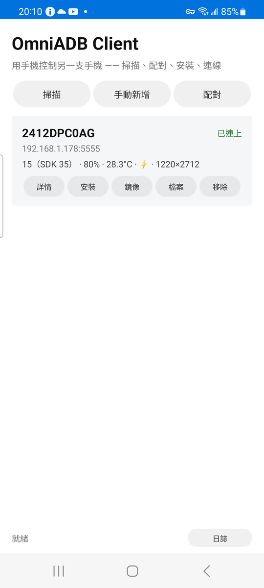
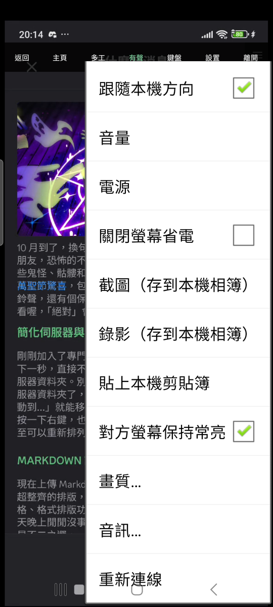
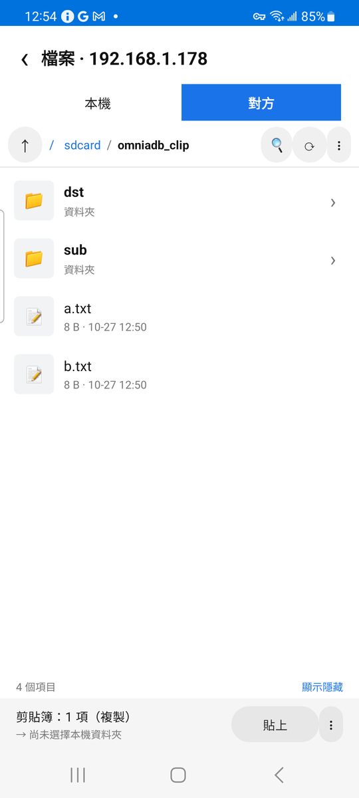
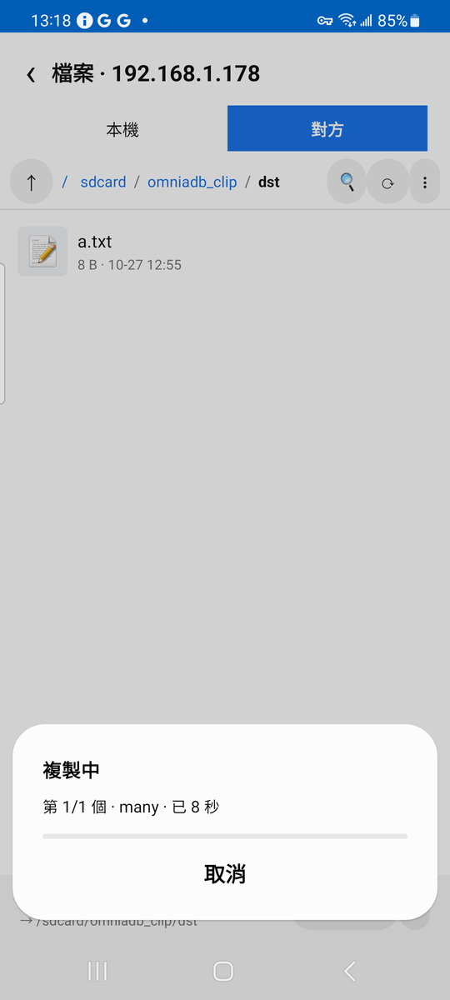
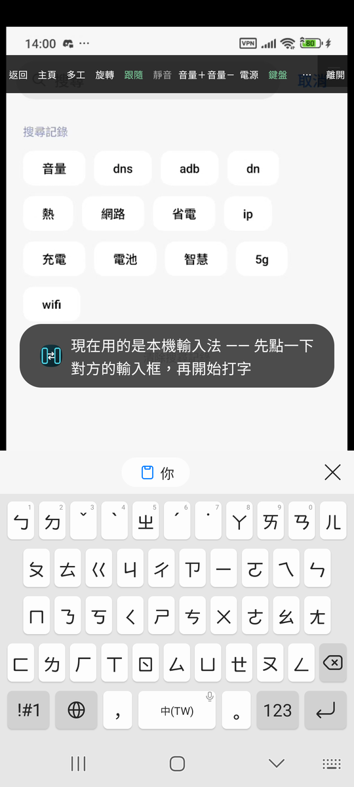
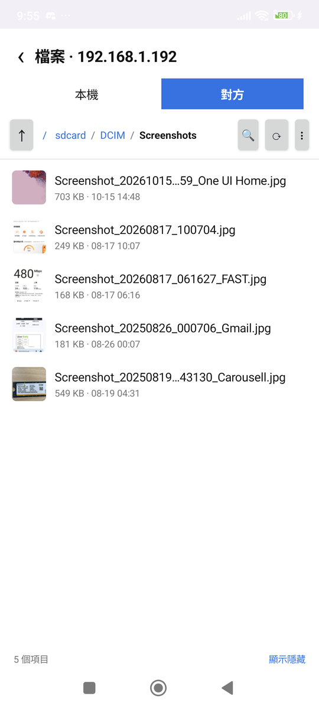

# OmniADB-Client

[English](README.md) · **繁體中文**

> **用手機控制另一支手機。** 掃描 → 配對 → 安裝 Host → 連線，全程不需要電腦。

<p align="center">
  
  
  
  
  <a href="https://github.com/tokyoxpa3/OmniADB-Client/actions/workflows/build.yml"></a>
</p>

<p align="center">
  
</p>

`OmniADB` 家族的第三塊拼圖，也是目前的主力：

| 專案 | 角色 | 平台 | 狀態 |
|---|---|---|---|
| [`OmniADB-Host`](https://github.com/tokyoxpa3/OmniADB-Host) | 被控端 —— 釘住 ADB 埠、重開機自己爬回來 | Android | ✅ 已發布 |
| **`OmniADB-Client`** | **控制端 —— A 機控 B 機** | **Android** | **✅ 0.5.1** |
| `OmniADB`（Python） | 電腦端控制台 / 多機監控牆 | Win / mac / Linux | ⏸ 擱置 |

## 要解決的問題

電腦版的 `python -m omniadb setup` 已經很順，但它要求你**人在電腦前**。
實際場景常常不是這樣：手機放在架上、在另一個房間、或根本沒有電腦在旁邊。

所以把整套流程搬到手機上 —— 兩支手機、同一個 Wi-Fi，就能掃描、配對、安裝、鏡像。

## 畫面

|  |  |  |
|---|---|---|
|  |  |  |
| **主畫面**<br>掃到就直接點「鏡像」 | **鏡像裡的設置**<br>畫質與音訊放在一起 | **檔案總管**<br>本機／對方同一個畫面 |
|  |  |  |
| **傳輸進度**<br>檔數與已等待秒數 | **遠端輸入**<br>用本機輸入法打對方的字 | **圖片縮圖**<br>遠端檔案也看得到預覽 |

---

## 能做什麼

### 連線

| 功能 | 說明 |
|---|---|
| 掃描 | mDNS 自動找附近開著無線偵錯的手機（`_adb-tls-connect` / `_adb-tls-pairing`） |
| 手動新增 | 直接打 `IP:埠`，跨網段或 mDNS 被擋時用 |
| 配對 | 輸入 6 位數配對碼；對方按「允許」後卡片自己變「已連上」，不用再點一次 |
| 安裝 Host | 一鍵把被控端釘在 5555 並跑完六步授權，之後重開機、換 Wi-Fi 都自己爬回來 |
| 記住的裝置 | IP + 型號 + 序號，同一台只留一筆；下次開 App 直接列出來 |

### 鏡像

| 功能 | 說明 |
|---|---|
| 全螢幕鏡像 | 等比例、多點觸控、挖孔與瀏海自動讓位；延遲約 100 ms 級（同一個 Wi-Fi） |
| 音訊 | 三種模式：**兩邊都有聲** / **只有我這邊有聲** / **不要聲音**，切換不會中斷畫面 |
| 畫質 | 720p/2 Mbps、1280p/6 Mbps、1600p/12 Mbps 三檔 |
| 旋轉 | 手動轉 90°，或「跟隨本機方向」讓對方跟著你的手機轉 |
| 關閉螢幕省電 | 對方**面板**關掉、串流照常 —— 適合掛著當監看螢幕；會記住偏好，離開時自動開回 |
| 截圖 | 抓對方原生解析度的畫面，不含本機的工具列 |
| 錄影 | 邊看邊錄成 MP4，不重編碼（畫質與串流一致）；有音訊時自動帶一條 AAC 音軌 |

### 操作

| 功能 | 說明 |
|---|---|
| 工具列 | 返回 / 主頁 / 多工 / 有聲·靜音 / 鍵盤 / 設置 / 離開，5 秒沒動自動收起 |
| 本機輸入法直通 | 用**自己的**輸入法打字（注音、拼音、英文都行），打完直接出現在對方輸入框 |
| 實體鍵盤 | 外接鍵盤也能直接打 |
| 貼上本機剪貼簿 | 已經複製好的內容，一鍵送過去並代按貼上 |
| 剪貼簿同步 | 兩邊複製的內容會互相流動（純文字） |
| 音量與電源 | 面板式音量（按住連發）、按一下電源鍵 |

### 檔案

| 功能 | 說明 |
|---|---|
| 雙窗格 | 「本機 / 對方」分頁，各自瀏覽 |
| 互傳 | 多選後整批傳，資料夾會遞迴 |
| 管理 | 新增資料夾、改名、刪除、詳細資訊、排序、跳到路徑、常用位置 |
| 縮圖 | 圖片在本機問系統、在對方抓回來解；兩層快取，只在可見時做 |
| 搬移 | 剪下／貼上（同側用 `cp`/`mv`，跨側走串流） |
| 撞名處理 | 覆蓋 / 兩份都留 / 取消，不預設任何一個 |

---

## 怎麼用

### 第一次（需要動手兩下，這是 Android 的安全邊界）

1. **B 機**：開發者選項 → 開「無線偵錯」
2. **B 機**：無線偵錯 → 「使用配對碼配對裝置」→ 看到 `IP:埠` 與 6 位數
3. **A 機**：按「掃描」，或「手動新增」輸入 B 的 IP
4. **A 機**：在那一列按「配對授權」→ 填配對埠與 6 位數
5. **A 機**：連上後按「安裝 Host」→ B 的 ADB 固定在 5555，重開機也會自己爬回來

> 兩支手機要在同一個 Wi-Fi、同一個網段。第一次配對時 B 會跳「允許 USB 偵錯嗎」，
> 勾「一律允許」就不會每次問。

### 日常

A 機開 App → 清單直接顯示 B（含電量、溫度、解析度）→ 點「鏡像」開始控制。

### 鏡像畫面

頂端一條會自動收起的工具列，**只有七顆**：返回 / 主頁 / 多工 / 有聲·靜音 / 鍵盤 / 設置 / 離開。
5 秒沒動就收起來，點右上角的 `≡` 再叫回來。系統返回鍵刻意不接管 —— 那是離開鏡像最直覺的方式。

**「設置」選單**分兩段（上面是對對方動手，下面是本機設定）：

| 選項 | 做什麼 | 要重連嗎 |
|---|---|---|
| 旋轉 | 鎖定對方方向，轉完本機才跟著轉 | 不用 |
| 跟隨本機方向 ☑ | 跟著本機感測器自動轉 | 不用 |
| 音量 | 面板式：`−` / `＋`，按住會連發 | 不用 |
| 電源 | 按一下對方的電源鍵（休眠／喚醒） | 不用 |
| 關閉螢幕省電 ☑ | 對方面板關掉、串流照常；**會記住** | 不用 |
| 貼上本機剪貼簿 | 送過去並代按貼上 | 不用 |
| 截圖 / 錄影 | 存到本機 `Pictures/OmniADB`、`Movies/OmniADB` | 不用 |
| 畫質… | 720p / 1280p / 1600p | **要** |
| 對方螢幕保持常亮 ☑ | 對方不會自己睡著 | **要** |
| 音訊… | 兩邊都有聲 / 只有我有聲 / 不要聲音 | 不用 |
| 重新連線 | 手動重連 | — |

勾選項（☑）勾＝現在開著。

---

## 限制

有些是 Android 的硬限制，不是這個 App 沒做：

| 限制 | 說明 |
|---|---|
| 本機（控制端）要 Android 8.0+ | 基本功能的下限；本機版本再舊也不影響音訊 |
| 被控端要 Android 8.0+ | 畫面、控制、檔案的下限 |
| **鏡像音訊要「被控端」Android 13+** | `AudioPlaybackCapture` 的硬門檻落在被控端。被控端 12 以下只有畫面；本機是 8 還是 15 都一樣 |
| 只抓得到媒體與遊戲聲音 | 通知音、通話、鈴聲抓不到 |
| App 可以拒絕被錄 | `allowAudioPlaybackCapture=false`（DRM 影音、少數播放器）—— 這時工具列的喇叭鈕會變暗 |
| 小米 / HyperOS 安裝要手動確認 | 系統會跳「繼續安裝」，10 秒倒數偶爾會贏過自動代按 |
| 長傳輸中切到別的 App 會斷 | 還沒有前景服務（見下面「已知問題」） |
| 剪貼簿只支援純文字 | 圖片與檔案目前不傳 |
| 需要同一個 Wi-Fi | 走的是 ADB over TCP，不是雲端穿透 |

> 音訊的版本門檻在**被控端**（誰把聲音交出來），不在本機（誰在聽）。
> 本機只負責把收到的 PCM 寫進 `AudioTrack` —— 那件事舊到 Android 4.0 就能做。
> 所以「A 機控 B 機」時，**只有 B 機的版本要緊**。

## 已知問題

- **前景服務**：檔案傳輸中切到別的 App 會斷線（`onStop` 關連線），長傳輸需要它撐著；鏡像目前只靠子母畫面
- 剪貼簿：`ClipData` 的圖片 / 檔案還沒處理
- 小米安裝確認框被 10 秒倒數搶先時，目前只會在對話框裡解釋原因，還沒做到「重試一次」
- 檔案總管還缺：拖曳搬移、影片縮圖、覆蓋前預覽兩邊的大小／時間
- 沒有自動化測試：`test/`、`androidTest/` 都還是空的，全靠實機驗證

---

## 建置

```bash
./gradlew assembleDebug     # app/build/outputs/apk/debug/app-debug.apk
./gradlew assembleRelease   # app/build/outputs/apk/release/app-release.apk（release 金鑰簽章，可直接 sideload）
```

需要 **JDK 17** 與 **Android SDK**（`compileSdk 35`）。

`local.properties` 不進版控（裡面是本機絕對路徑），新 clone 下來要先自己建一份：

```properties
sdk.dir=/path/to/Android/Sdk
```

用 Android Studio 開啟專案時會自動產生，命令列建置則需要手動寫。

> 手機上裝不起來、又不想清資料的話，用 `./gradlew assembleDebug -PdevSuffix`：包名會變成
> `com.omniadb.client.dev`，可以和原本那顆並存（注意 `FileProvider` 的 authorities 會跟著
> 包名走，所以兩個包只能存在一個）。

**關於 release 簽章**

正式發佈的 APK 用一把固定的 release 金鑰簽章，金鑰檔放在 repo 外，路徑與密碼由根目錄的
`keystore.properties` 指定（該檔已在 `.gitignore` 內）。這個檔案不存在時（例如別人 clone
下來），`assembleRelease` 會退回你本機的 debug 金鑰，保證建得起來，但那種產物只適合自己測。

由此衍生兩件事：

- **自己建置的 APK 蓋不過官方版**（`INSTALL_FAILED_UPDATE_INCOMPATIBLE`，小米會顯示「應用程式
  套件與現有套件衝突」），因為簽章不同。要裝就得先卸載官方版 —— 那會一併清掉 App 裡存的
  裝置清單與 ADB 金鑰。
- **每一台機器、每一個 CI 都必須用同一把金鑰**，否則發出去的版本無法覆蓋升級。這也是這裡
  不再用 debug 金鑰（每個開發機一份）的原因。

---

## 安全性

- **ADB 等同完整系統控制權。** 只在自己的家用網路使用，
  不要在公共 Wi-Fi 開著無線偵錯，也不要把 5555 埠轉發到外網。
- 控制端的 ADB 金鑰存在 App 私有目錄，所有遠端裝置共用同一把 ——
  這樣 B 的「已授權裝置」清單裡只有一條 `OmniADB-Client`。
- 解除安裝 App 會清掉金鑰，需要重新配對（跟 Host 的 `WRITE_SECURE_SETTINGS` 一樣）。

---

## 致謝

- [`libadb-android`](https://github.com/MuntashirAkon/libadb-android) — ADB 協定與 SPAKE2 配對
- [`scrcpy`](https://github.com/Genymobile/scrcpy)（Apache-2.0）— 影像管線與控制協定
  （只用它的 `scrcpy-server.jar`，客戶端是自己寫的：MediaCodec + SurfaceView）
- `OmniADB-Host` — 同一套金鑰管理與 provider 初始化

---

## 授權

本專案以 **MIT** 釋出，見 [`LICENSE`](LICENSE)。

第三方元件的授權（libadb-android 為 GPL-3.0-or-later **或** Apache-2.0 雙授權，
本專案選擇 Apache-2.0 分支；scrcpy、Conscrypt、AndroidX 為 Apache-2.0；
Bouncy Castle 為 MIT 風格）整理在
[`THIRD-PARTY-NOTICES.md`](THIRD-PARTY-NOTICES.md)，上游原始授權檔在 `LICENSES/`。

---

<sub>要改這個專案的話，實作細節、實測數據與踩過的坑都在 [`docs/INTERNALS.md`](docs/INTERNALS.md)。</sub>
